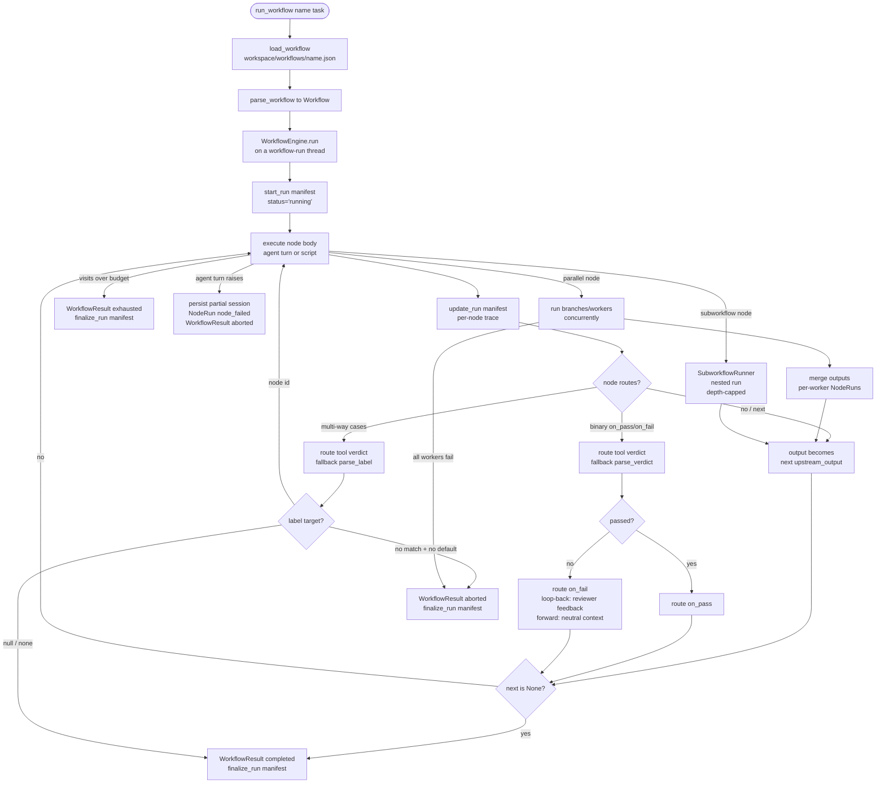

# Workflow engine — User-defined flow graphs

## 1. Purpose

The workflow engine lets a user define a multi-step process as a **flow graph** and
run a task through it. Instead of a single agent turn, a task moves through a graph
of **nodes** the user draws. A node does a piece of the task — a real agent turn with
its own model, tools, and session — and **optionally routes** the
flow (continue, branch, or loop back) on a pass/fail verdict. Routing is opt-in, not a
separate node type. The graph is a plain JSON
document under `<workspace>/workflows/<name>.json`, so it can be authored by a human,
a UI, or an agent; the agent runs one with the `run_workflow` tool.

The engine is **deterministic**: the user's graph drives routing; the LLM does the
work *inside* nodes, it does not decide the path. It runs *above* `AgentRunner` (the
core agent loop is untouched) and reuses the session-lineage primitive, so every
node's work is a persisted, searchable session rather than ephemeral state.

## 2. Mental model

**A workflow is a graph of nodes, not a fixed pipeline.** A `Workflow`
(`durin/workflow/spec.py`) is a set of nodes keyed by id, a `start` node id, and a
per-node visit cap (`max_visits`). A node that does the actual work is one of two
kinds: an agent **work node** (`WorkNode`) — it carries a model (or the default), a
context policy (`own` vs `shared` session), a tool set (`none` vs `default`), a prompt,
optional skills/MCP — or a **script node** (`ScriptNode`) — a deterministic subprocess
run in place of an agent turn (see below). Both carry either a single `next` edge or —
when the node **routes** — a pair of targets (`on_pass`, `on_fail`) or a `cases` map. A
`None`/`null` target ends the run. The parser validates that the start and every edge
target name a real node, and that `next` and routing are not both set.

**Workflow I/O is first-class.** A `Workflow` carries optional `input` (`{text?, file?, description?}`)
and `output` descriptors — rendered as distinct **Input** and **Output** objects on the canvas. The text
input becomes the start node's task; input files are placed in the run's shared working folder, so the
start node (and every later step) reads them there. Multiple input files pair naturally
with dynamic fan-out (a worker per file). The terminal node's text output and the shared working folder are
exposed in the run result. Absent ⇒ today's text-task behavior. The optional free-text `description`
is a lightweight contract: the engine frames every agent node's task with the input description (what
the run received) and the output description (what it must deliver), so the agents are steered and the
interface is documented — descriptions are hints, not enforced. Script nodes never see the framing: they
get the task exactly as the caller passed it (`NodeRunRequest.raw_task`), because a script parses its
input as data and an example in a description would read as a value. A subworkflow node at the start
position likewise hands the child the unframed task, so the child frames it once, with its own
descriptions. The output descriptor may
additionally declare **`artifacts`** — a list of `{path, description?}` naming the files (relative
to the run's working folder) the run promises to produce. Declared paths are validated at parse
time (relative, no `..`, no duplicates), ride in every agent node's framing as the file contract, and
after a completed run the engine reports the ones not produced (by any walk of the run, so a
resumed run counts the files written before it stopped that are still in its working
folder) as `missing_artifacts` on the
result and manifest — a **warning, never a failure** — so an orchestrating caller or a composed
downstream stage learns immediately which promised file is absent instead of failing confusingly
later. However, **provided input files are validated pre-flight** (existence check, distinct basenames) and return an `aborted` result naming any missing or colliding file; and a workflow that declares file input (`file: true`) given none ends the run immediately with a `needs_input` result before any node runs, so the invoking agent asks the user for the files instead of burning node turns.

A caller may also pass a per-run **`output_format`** (the `run_workflow` tool, the run command):
a delivery instruction for THIS call — "a bulleted list", "JSON with fields x,y", "a 3-line
summary" — that overrides the workflow's default output description in the framing, so one
workflow can deliver its result in whatever shape the caller needs without being edited. The
same callers may pass **`input_files`** (absolute paths) — seeded into the run's shared working
folder before the start node runs, each **under its original basename**: a workflow whose nodes
expect `context.json` must be handed a file *named* `context.json`, not a renamed copy — and
read the terminal **`output_dir`** back from the result;
both the `run_workflow` tool and the HTTP run surface accept files in and report the folder out.
The run result also reports the relative list of files in the shared folder, so the invoking agent
sees what deliverables were produced and where to copy them from.

**A node runs its body, then optionally routes.** `WorkflowEngine.run`
(`durin/workflow/engine.py`) walks the graph from `start`. For an agent node it calls a
`NodeRunner` — by default `AgentNodeRunner` (`durin/workflow/node_runner.py`), which
runs one `AgentRunner` turn with that node's model and tool registry (with
`concurrent_tools` enabled, so a node's independent concurrency-safe tool calls — batch
fetches, parallel reads — run in parallel like the main loop's and subagents'; mutations
stay serial), then persists
the node's conversation as a session keyed `workflow:<run_id>:<node_id>:<iteration>`
with lineage (`origin_type="workflow_node"`). The node's session telemetry logger is
bound for the whole execution, so its tool events and per-call `provider.call`
token/latency records land in a `workflow_<run>_<node>` telemetry file (see
`docs/internals/observability.md`). The engine itself emits no run- or node-level
telemetry event: what a run cost is read by joining its manifest with those per-node
files, which is what the `workflow_runs` tool's `cost` action does (§6). A node is configured independently and
focused by default. Its **work mode** is an `AgentMode` (`durin/agent/agent_mode.py`) —
for nodes, `build` (full access, neutral posture) for steps that create or edit files and
`read` (read-only, neutral posture) for steps that inspect, analyse, or judge; or a
registered custom mode — that sets the node's posture (a prompt suffix) and filters its
tool registry to what the mode allows, so a read-only node literally cannot write
regardless of what the model attempts. The node's runs are also gated by that mode the
way a chat turn is gated by the session's (`mode_provider` on the run spec): a call the
mode refuses is refused, descriptions that name other tools list only allowed ones, and
an `execute_code` script's calls answer to the mode too. A node's MCP tools are
registered under their own names (a node registry never defers them), so the gate
decides each by name. The gate mode is built by `node_gate_mode()`: the tools the engine
adds after filtering (`route`, `deliver`, `deliver_file`) are allowed whatever the mode
denies, an allowlist is narrowed to the tools the node actually has, and the mode is
unattended, so a refusal tells the step which tools it has and to finish with them
rather than asking for a person or a mode switch. Apart from that wording, a `build` or
`read` node sends the provider the same messages and tool definitions it would with no
mode on the run. The interactive `plan`/`explore` modes also exist
but carry conversation/sub-agent framing (exit_plan_mode, "the parent should /build",
fail-fast-if-modification) that derails a workflow node — e.g. a `verify` gate told it is
a read-only sub-agent that should bail stops emitting its verdict; nodes use the neutral
`build`/`read` instead. Besides the mode, a node carries its model, context and built-in
`tools` — `"default"` loads the `subagent`-scoped background set with a context that
carries `aux_providers` and `app_config`, so memory writes and the vision/audio bridges
register for a node the same way they do for a spawned sub-agent (see
[tools.md](tools.md) for the scope/context gates); the mode then subtracts from that
set — plus the **skills** to inject into its own prompt (loaded the same way the main
agent loads a skill) and the **MCP servers** whose tools it may use — a scoped subset of
the already-configured servers, reused from the gateway's live connections (no per-node
reconnect; the call is marshalled back to the gateway's event loop, where the MCP
session lives). Skills/MCP default empty, so a node sees only what its job needs. The node's output passes along the edge
as the next node's input. A `shared`-context node reads and extends a running
conversation buffer; an `own`-context node is isolated and receives only the upstream
output. **Output travels two channels.** The **text** of a node's output is the edge — it
becomes the next node's input (above). For **files**, every sequential agent node with file
tools shares ONE **working folder** for the run (`<workspace>/.workflow/<run>/work/`,
`durin/workflow/artifacts.py`) — it reads earlier steps' files there and writes its own there.
The node's prompt names the folder as its working directory and names the workspace root, and
the node's tools that take a path (`read_file`, `write_file`, `edit_file`, `list_dir`, `grep`,
`repo_overview`, `interpret_image`, `interpret_audio`, `convert_to_markdown`, `memory_ingest`)
resolve a relative one there (`ToolContext.work_dir`):
- a path under a managed top-level name (`workflows/`, `memory/`, `skills/`, ...) still
  resolves from the workspace root, as in the chat's work area, and an absolute path is used
  as given;
- a read of a path the folder does not have, into a folder at the workspace root (a repository
  checked out there, such as `mxhero-repos/…`), reads the root's (`work_area.read_base`) —
  never a file lying at the root itself, so a stray file another run left there is not read
  in place of this run's, and never a write, which always lands in the folder;
- `deliver_file` resolves by the same rule, so a path names the file `write_file` wrote (one in
  a managed area is then refused as outside the folder).

`grep` prints, and `repo_overview` names, paths that lead back to what they found (relative
inside the folder, from the workspace root in a managed area, absolute elsewhere).
`execute_code` runs its script in the folder, so the script's own `open()` reads what its
`read_file` calls read. `exec` keeps starting in the workspace root, where a workflow's scripts
are run as `python3 workflows/scripts/...`; a node that has it is told so in its prompt, with
the advice to `cd` into the folder or give full paths.
Because it is one shared folder, created and edited files accumulate in a single place and
each stage (including a loop's re-iterations) sees the prior work, so stages can collaborate
on an evolving fileset (e.g. a debug loop's reproduction test, code, and fix) rather than
hand a copy down a chain. A writing parallel branch (`choose`/`union`) works in a private copy of
this folder only, never of the workspace around it: it starts from the folder's current
files and its writes reconcile back into the folder; read branches and dynamic fan-out
workers are handed the shared folder directly. The `.workflow` tree gitignores
itself and is pruned to recent runs — with a status exemption: folders belonging to runs
that are still executing, or paused at `needs_input` with a resume point, are never
deleted and never count toward the retention window (`prune_runs`'s `protect` set, fed
from `run_log.live_run_ids`). Age alone cannot protect a live run — a long node freezes
its folder's mtime, so enough concurrent runs starting during it would otherwise evict
a mid-flight run's working folder. The folder pruner and the manifest pruner (§4a
Retention) therefore agree on what "live" means. (Real deliverables a node writes into
the workspace proper are the separate, already-shared filesystem channel.) **When a node routes**, the engine derives a verdict from what the node produced
and follows an edge. A node may route in one of two shapes:

**Binary routing** (`on_pass`/`on_fail`): a routing node ends its turn by calling its `route`
tool with `PASS` or `FAIL`, its text ending with the same verdict on its last line, which the
engine parses when no call arrives (§4d, `durin/workflow/verdict.py`) — so a routing node can
*verify* (read the diff, run the tests) before ruling, not just read text. The engine routes to `on_pass` or
`on_fail`. How a fail's output is threaded depends on the graph: when the `on_fail` target
can lead back to the gate without passing through the gate's `on_pass` target (the fail path
returns on a route the pass path does not share), the fail is a loop-back and the output is
threaded as `Reviewer feedback (address this):` so the producer re-runs knowing what to fix.
That holds whether or not the target has run yet, so a fixer reached for the first time from a
failing review, or a review that fails right after a resume, still frames it as feedback.
Otherwise the fail is a forward route (a check whose "no" is a normal branch, e.g. "no note
yet → go draft it") and the output is threaded with the same neutral `Context from '<node>':`
framing a `cases` route uses, so the next step never reads a routine "no" as an earlier
failure. That includes a target that comes back to the gate only by way of `on_pass`: when the
drafting step goes on to the pass step, a retry edge or an outer loop over items that later
re-enters the check is a cycle of the pass route, not of the fail. Only edges the walk follows
count as paths: `next`, `on_pass`/`on_fail`, `cases` targets, and a parallel node's `next` (its
branches, worker and list source run inside it or before it). Two shapes stay ambiguous,
because the graph cannot tell a routine "no" from a verdict on earlier work: a check whose
`on_fail` step leads straight back to it (check → create → check again) reads as a loop-back,
so the creating step gets reviewer framing even on its first run (declare such a check with
`cases` for neutral framing); and a review whose fix step goes on to the pass route instead of
back to the review reads as a forward route, so the fix step gets the verdict under neutral
framing (the verdict text itself still arrives). `NodeRunRequest.fail_loops_back` hands the
node's runner the same answer (the script runner words its exit note from it, below). When the on_fail target has no visits left, the gate is told a FAIL now ends the run (no further revision), so its last verdict is definitive — PASS with noted caveats, or FAIL with a final summary — rather than another loop instruction that can never be acted on.

**Multi-way routing** (`cases`): an agent node declares a set of labeled outcomes
(`{"GROUNDED": null, "MISSING": "plan", "MISUSED": "synthesize"}`). It ends its turn by calling
`route` with exactly one label, its text ending with that label; when no call arrives the
engine matches the last non-empty line of the output against the declared
labels (case-insensitive, surrounding punctuation tolerated), then follows the matching edge.
A `null` target ends the run; any other target is a node id. If the output matches no label the
engine tries a `"default"` key — if that is also absent, the run ends as `aborted` naming the
node and the sorted list of expected labels. Before routing to a non-terminal target, the
node's output is threaded as neutral context (`Context from '<node>':`), since a case is a
dispatch between normal paths rather than a verdict on earlier work. The matched label is
recorded in the `NodeRun` trace (`route_label`); `passed` is `None` (pass/fail does not apply).
Binary `on_pass`/`on_fail` is the 2-way special case of this pattern; `cases`, `on_pass`/`on_fail`,
and `next` are mutually exclusive. Routing nodes default to **read** (read-only, neutral posture) mode and every other work node to `build`; an explicit `mode` is kept as written. The `route` tool is registered after the mode filter, so a read-only gate always has it.

**A script node runs a deterministic subprocess instead of an agent turn.** A
`ScriptNode` (`durin/workflow/spec.py`) sets exactly one of `command` (inline, run via
`bash -c`) or `script` (a file under `<workspace>/workflows/scripts/`, validated at
parse time to be a relative path with no `..`); the parser rejects any agent-only
field (`model`, `persona`, `context`, `session`, `prompt`, `mode`, `tools`, `skills`,
`mcps`, `max_turns`, `max_reentries`, `reentry_prompt`) on a script node. `ScriptNodeRunner`
(`durin/workflow/script_runner.py`) executes it: a `.py` script runs under the current
interpreter, a `.sh` script under `bash`, anything else must be directly executable (a
shebang); an inline `command` always runs via `bash -c`. **stdin** carries the upstream
edge text — a node at the **start** position (no upstream output yet) receives the
run's task instead, since the run's task is the incoming edge of the start node — the
task as the caller passed it, without the input/output framing agent nodes get; an
upstream node that produced an empty string stays empty (no fallback). Small run
metadata rides in `DURIN_TASK`/`DURIN_RUN_ID`/`DURIN_NODE_ID`/`DURIN_ITERATION`/
`DURIN_WORK_DIR` env vars (`DURIN_TASK` is capped — env values have platform size
limits that stdin does not). The rest of the subprocess environment is controlled
by the node's `env` field: `"clean"` (the default) starts from a minimal allowlist
(`PATH`, `HOME`, `USER`, `SHELL`, `LANG`, `LC_ALL`, `LC_CTYPE`, `TERM`, `TMPDIR`,
`DURIN_HOME` — only those present); `"inherit"` is the gateway process environment, opt-in
per node (see [security.md](security.md)). Neither mode carries stored
secrets: the gateway's environment also holds credentials it loaded from the
store for its own clients (provider API keys), so `inherit` leaves out every
variable whose value is a stored secret (`ScriptNodeRunner._base_env`). A node
that must authenticate declares the names it needs in **`secrets`**: each is
resolved from the store into the subprocess env (the entry's `scope` must allow
the `exec` consumer, the same grant the exec tool honours), validated pre-flight
(an unknown or scope-denied name aborts the run naming the node, before any node
executes), and never able to shadow the `DURIN_*` metadata vars. Both streams are
redacted against the store before becoming edge/feedback text, so a script that
echoes a credential cannot persist it into sessions, manifests, or memory. **cwd** is the
run's shared working folder, so a script reads earlier steps' files and writes
its own the same way a `tools: "default"` work node does. **stdout** (capped
at `workflow.script_output_max_chars`, truncated with a
notice past the cap, and flagged as cut on the response) becomes the edge text to the next
node — except that a fan-out refuses a cut list (see the parallel node below); **stderr** is
diagnostic-only — never part of the edge text, though a failing binary gate folds a
tail of it into the loop-back feedback (below). Output is decoded with
`errors="replace"` so non-UTF-8 bytes degrade rather than crashing the runner. A script
node has no session — `session_key` is always `None` and it never persists a
conversation. Its record is the manifest instead: the command it ran and both
streams, redacted and capped at `workflow.script_log_max_chars`, on every exit
path (§4a) — without which a script that succeeded would leave nothing at all to
read.

**Script routing is exit-code-driven, not text-parsed.** A binary script gate
(`on_pass`/`on_fail`) routes on the process exit code: `0` is `PASS` (output = stdout);
non-zero is `FAIL`, and the node's output becomes stdout plus a stderr tail plus an
explicit exit-code note, so the loop-back feedback explains what failed. The note follows
the same `fail_loops_back` rule as the engine's framing: `[script gate failed: exit code N]`
when the fail is a loop-back, a plain `[exit code N]` on a forward route. A multi-way
script node (`cases`) routes on the **last non-empty stdout line**, exactly like an
agent's multi-way output (`parse_label`), but requires a `0` exit — a non-zero exit on
a `cases` node, or on a plain linear node with no routing, is a node failure
(`NodeExecutionError`, aborting the run), not a verdict, since half-produced script
output is not a trustworthy label. A script node's timeout (its own `timeout`, else
`workflow.script_timeout`) kills the whole process group on expiry so orphaned
children die with it, and that too surfaces as a node failure (§4c). **Script nodes are
exempt from the anti-Goodhart guard** below — their verdict is a deterministic exit
code or stdout line, not a model's judgment of its own producer's work, so there is no
structural-identity risk to guard against. A script node also never reads or extends
the shared-context buffer (`context: "shared"` is not a script-node field): inserted
into a chain of `shared` work nodes, it simply passes the buffer through untouched.

**Independence is a graph rule, not a node type:** the
parser rejects a routing agent node that is *structurally identical* (same model, mode,
and prompt) to the producer feeding it, so a quality verdict comes from a genuinely
independent reviewer (the anti-Goodhart guard). A node can also be a **sub-workflow**
(`durin/workflow/subworkflow.py`): it runs another named workflow as a nested run
(reusing the same node and branch-pick runners, bounded by three recursion layers) and uses its output;
the nested run carries the same root session key, so its node sessions anchor to the
invoking conversation too. The three layers are: (1) the editor excludes cycle-creating
targets from the sub-workflow picker, so a cycle cannot be authored in the UI; (2) the
runner maintains a call-stack of workflow names currently executing — if a name is about
to reenter the chain, it stops immediately with a cycle error (`"Error: workflow cycle
detected: A -> B -> A"`) rather than recursing; (3) a `max_depth` counter is the backstop
for deep non-cyclic chains, returning an error at the limit. A sub-workflow runs in the
**parent run's shared working folder** — its nodes read and extend the same fileset as
the parent's sequential nodes (text still travels the edge; files never needed copying).
**The child's terminal status propagates to the parent.** The runner returns the child's
full result, and the parent maps it: `completed` threads the output onward; `needs_input`
pauses the *parent* run the same way, keyed to the sub-workflow node — resuming re-enters
there and re-runs the child with the framed answers as its task (its prior files persist
in the shared folder); `cancelled` mirrors; `aborted`/`exhausted` abort the parent with a
message naming the child and its reason, and the node records `node_failed`. Cycle,
depth-cap, and missing-workflow errors take the aborted path too — an unrunnable child
stops the run instead of threading an error string downstream as if it were output. The
sub-workflow node's wall-clock `duration_s` is recorded in the parent's trace like any
other node's.
A node may declare **named inputs** (`inputs_from`): its input becomes one labeled block
`[source-id]` per named node — the source's last recorded output this run, falling back on
a resumed run to the manifest's `resume_inputs` seeds — always followed by an `[upstream]`
block carrying the walk's current edge text, so loop-back feedback and route context are
never lost and a script chain between producer and consumer needs no courier files.
`resume_inputs` keeps the last output of every node another node names as a source —
`inputs_from`, and a parallel node's `list_from` / `branches_from` — because a resumed
walk starts with an empty trace: a parallel node past the resume point reads its list
or its branch ids from there when the source ran before it. The stored outputs are
carried forward from one resume to the next, so a run that stops again after a resume
still holds the sources of its first attempt. The copies on the record are capped; a
resume given the workspace reads each source whole from the run's resume store instead
(§4a, "What a step receives is kept whole") and marks it whole on the `ResumeState`
(`whole_outputs`). A composed input shows a capped copy as it is; a parallel node whose
source is a capped copy that reached the cap aborts instead of parsing a list from a
fragment, while a source read whole is parsed whatever its length.
A work node may declare a **structured output** (`output_schema`): the node runner forces a
`deliver` tool call whose parameters ARE the schema (the same machinery as the `route`
verdict), validates the payload server-side (jsonschema), retries immediately inside the
node with the exact validation error, and fails the node after the attempt budget — no
text fallback. Every schema rejection (from `deliver`, `deliver_file` or the forced call)
names the failing field by its path in the payload and why it failed, and quotes only the
start of the value that failed: jsonschema's own message repeats the whole value, which for
a long text field is thousands of characters the model has just written.
`deliver` and `route` are registered in the node's own tool registry from
turn 1, not appended only at this forced call, so the `tools` array — and the prompt-cache
prefix it anchors — stays identical between every work-loop round and this final call. A
schema-valid `deliver` call made mid-loop is accepted immediately as the node's output,
skipping the forced call entirely; an invalid one returns the validation error and lets the
model keep working. A node that has a working folder (one with the file tools) also gets
**`deliver_file(path)`**: it reads the payload from a JSON file in that folder and runs
the same schema check into the same capture (the last valid delivery of either tool wins).
A node that drafts and checks its output in a file delivers exactly that file instead of
retyping it, and a rejection — which names the failing field by its path in the payload —
is fixed by editing the file in place and calling again. It is a separate tool rather than a
property on `deliver`, because `deliver`'s parameters ARE the output schema and an added
property could collide with a schema field. The path is relative to the working folder or
absolute inside it; an absolute path elsewhere, a `..` escape, or a symlink leading out is
refused, as is a file whose top level is not a JSON object (what `deliver`'s arguments
always are). A rejection is a plain reply, not an `Error` result: the agent loop blocks an
identical call that failed with an error, and fixing or writing the file leaves the call
identical. `deliver`'s description points at `deliver_file` only when the node has it.
The end-of-turn forced call names `deliver` in `tool_choice`, but a provider may send that
as `auto` (the Anthropic provider does with thinking on, and after a model refuses a forced
tool), so its answer is read by tool name: a `deliver` call's arguments are the payload, a
`deliver_file` call gets the tool's own read and schema check (no tool runs during the
forced call, so a rejected draft is corrected through `deliver`), and a call to any other
tool counts as no delivery — its arguments are never read as the payload.
A valid `route` call decides the verdict and ends the node's turn once its round of tool
calls finishes (`AgentRunSpec.end_turn_after_tools`), with no request after it (§4d). The
forced-tool calls (route / re-entry / deliver) are sent from the work-loop run's messages the
way that run would send its next request (`AgentRunner.request_view`, given the run's
`AgentRunResult.prune_state`): results the loop pruned stay pruned, placeholders byte for
byte, the request is fitted under the same input budget, and its `max_tokens` is the model's
output cap clamped to the room the prompt leaves in the window, as the loop's own requests
are (the model's configured cap, not a hardcoded signature default, when no window is
known). A forced call built from the whole unpruned history with the full output cap could
exceed the budget the loop kept to, miss its cached prefix, and ask for more than the window
holds — which a provider that checks prompt plus output against the window rejects.
They go through
`chat_with_retry`, so transient transport failures retry. The delivery loop
reads `finish_reason`: a `length` response is named as truncation and the retry is steered
toward a more concise payload (a truncated tool-call JSON otherwise repairs into a partial
object and gets misreported as a missing required field); an `error` response fails the
node immediately with the provider's message instead of burning the remaining attempts. The delivery instruction names the schema's required fields up front, so
a required-property miss costs a retry only when the model ignores an explicit list, not
because it had to infer the contract from the schema alone. The node's output is the validated payload as JSON, and with `output_file`
the ENGINE writes it into the working folder (the model never types the file) once the
step ends — on the main walk only: a parallel branch, fan-out worker or detached node's
`output_file` is not written. The main walk passes the file on the node's request
(`NodeRunRequest.output_file`), and both delivery replies then name it, so the model does
not look for it right after delivering, miss it, and write it by hand only for the engine to
overwrite it; a node dispatched any other way gets no such line.
Alongside `output_file`, the engine stamps **artifact provenance**: `work/.provenance.json` maps each engine-written file to who produced it — a hash of the producing node's reuse-relevant definition fields (routing-only/display edits like `next`/`on_fail`/`title` are excluded via a denylist, so they never invalidate reuse; an unrecognized future field is NOT excluded by default, so it still invalidates reuse rather than being silently ignored), the resolved model/provider, a generation-params hash, a hash of the exact `(task, composed-upstream-input)` pair the node was dispatched with (`input_hash`), a hash of the artifact's own text content (`content_sha256`), and the durin version — best-effort like the `output_file` write itself, never fatal; when the stamp itself fails, the engine best-effort drops any stale entry for the same filename rather than leaving it standing over content that just changed. Run manifests carry the same producer identity at coarser grain: a top-level `spec_hash` — over every node's identity (an agent node's raw spec; a script/subworkflow/parallel node's parsed definition, since those carry no raw field) — plus `durin_version`, and, on the row of a node pass that finished, `model`/`provider` (agent nodes) and `node_hash` (work nodes) — whether the node ran on the linear walk, as a static branch, as a fan-out worker, or detached. A failed pass carries none of the three (a failure names no producer), and neither do the subworkflow and parallel-aggregate rows: they stand for several nodes and have no single resolvable model.
A work node may declare **`reuse: "if-unchanged"`** (requires `output_file`; one without the other is a parse-time spec error). Before dispatching, the engine asks the node runner for the producer identity a run right now WOULD stamp (model, provider, params hash) and compares it, alongside the node's current `reuse_hash` and the CURRENT composed input (task + upstream/`inputs_from` text, hashed the same way as `input_hash`), against the `output_file`'s provenance entry — all must match exactly, and the file's CURRENT bytes must still hash to the entry's `content_sha256`; a `None` on either side of any single comparison (an unresolvable identity, or a work folder with no recorded provenance — e.g. a legacy folder) always means "run normally", never "reuse". A same-run revisit (this node's second or later visit within the current walk) never reuses either, regardless of what else matches — belt and suspenders, since a revisit only happens after a loop-back, which means upstream feedback exists. On a match the runner is never dispatched: the artifact's text becomes the node's output (`output_schema`, required by `output_file`, already rules out routing here), while the node's trace record gets `status: "reused"` and `origin_run_id` (the run that actually produced the file) in place of `ok`/`persist_failed`, `duration_s: 0`, and does NOT re-stamp provenance — the original entry, still accurate, stands. `reuse` is rejected at parse time on a `detached` node and on a parallel branch/worker (neither dispatch path ever checks the reuse gate), together with `context: "shared"` (a reuse hit would silently contribute no messages to the shared buffer that pass), and — for ANY node in the workflow — when a `branches_from` parallel node declares no candidate `branches` pool (with no pool every node is runtime-selectable, so the parser cannot rule out the reuse node being one of them). A reused pass still records no session for `session: "persistent"` — the original run's session remains the trace. The gate needs a SHARED working folder to ever find anything: a fresh top-level run always mints a new `run_id` and, by default, a fresh (empty) folder under it, so its `.provenance.json` starts empty and reuse never fires. Three entrances give a run a folder that already carries an earlier pass's stamp instead: (a) `WorkflowEngine.run`'s `work_key` param — a caller-supplied key (workflow tool, HTTP launch route, automations) picks a STABLE folder under `.workflow/keys/<safe workflow name>/<safe work_key>/` shared by every run with that same key (each segment is `artifacts.safe_key`'s collision-proof `<sanitized-prefix, capped 60 chars>-<sha256(the original value)[:8]>` — never the bare sanitized text alone, so two DIFFERENT names that happen to sanitize alike, e.g. `"Ticket #1"` and `"ticket_#1"`, still land in different folders); (b) an automation's re-entry (an answered `waiting_info` run) or an aborted/needs_input/crashed run's `resume_run_id` — both re-enter the SAME run_id and therefore the same folder; (c) a subworkflow, which always shares its parent run's folder. Without one of these, reuse is unreachable no matter how a node is configured. A `work_key` folder is SHARED across separate runs, so `WorkflowEngine.run` holds a cross-process lock on it for the run's full duration — two runs sharing a key SERIALIZE (the second waits for the first to finish, then typically reuses what it just stamped) rather than racing to write the same `output_file`. Unlike a per-run folder (bounded by `keep_runs`), a keyed folder has no run_id to age out by count — it is instead reaped by elapsed idle time: `artifacts.prune_runs` removes a `keys/<workflow>/<key>/` dir once its newest content is older than `KEYED_WORK_MAX_AGE_DAYS` (30) days, unless a run currently holds its lock (left untouched regardless of age) OR its `(workflow, work_key)` still names a live manifest — running, or a resumable `needs_input` (`run_log.live_work_keys`) — since a PARKED run releases this same lock the instant it parks, well before anyone answers it, so the lock check alone cannot tell a merely-idle key apart from one still awaiting a reply. The sweep itself runs at most once every `KEYED_SWEEP_MIN_INTERVAL_S` (a day), tracked by an on-disk marker (`keys/.last-sweep`) rather than every single run, since its recursive per-dir mtime walk would otherwise cost O(total keyed-folder size) on every workflow run in a workspace with many keys.
A `work_key` folder being shared across separate runs is exactly what the reuse gate needs
for `output_file`/`.provenance.json`, but it is a liability for anything else a node writes
ad hoc into that same folder (a script's own output file, say) — nothing else stops the
NEXT run sharing that key from silently overwriting it. So a node that owns a keyed folder
(not a subworkflow, which always shares its parent's folder unchanged) also gets a copy of
whatever it created or overwrote preserved under `<work_dir>/runs/<run_id>/`
(`artifacts.run_evidence_dir`) — detected by a before/after mtime fingerprint of the folder
scoped to this node's turn, not by `NodeRun.artifacts`'s existence-only diff (see the table
below), since the latter would miss a run overwriting a SAME-NAMED file an earlier run
already left there. The shared, top-level copy `output_file`/provenance touch is never
duplicated there beyond this best-effort snapshot; a reader (`WorkflowRunsTool.show`) checks
the run's own `runs/<run_id>/` subfolder first and falls back to the flat, shared layout when
it does not exist — a run recorded before this existed. The fingerprint is `mtime_ns`, not a
content hash, so a filesystem with coarse mtime resolution can in principle miss an overwrite
that lands within that resolution window.

A work or script node may be **detached** (`detached: true`): the walk launches it on a
small per-run executor and continues immediately along its `next` — the upstream edge text
passes THROUGH unchanged (the detached node and the next node both receive it), its output
never rides an edge and never becomes `final_output`. It exists for side effects (persist
to memory, notify, archive) that must not sit on the critical path. Every terminal return
path **joins** pending detached nodes before the manifest is finalized, and finished ones
are drained into the trace at each per-node manifest refresh (in-flight visibility). Until
its row is in the trace, a launched detached node is listed in the record's
`detached_active` (§4a), so a process that dies with it running leaves it on record. A
detached node that fails records `node_failed` WITHOUT changing the run status — a side
effect must not sink the deliverable (the same philosophy as `persist_failed`). Parse-time
constraints: linear `next` only (no routing — its verdict could never reach the walk), no
`context: "shared"`, never a parallel branch/worker, and never the target of a routing
edge (a loop-back into a possibly-still-running node is undefined). Detached nodes should
read and persist, not produce files the main path consumes — nothing downstream reads them.

A work node may instead declare **`approval: true`**: after the node's own turn, the
walk pauses on its output instead of threading it onward — the output is a **proposal**
a person must approve, revise, or reject before the run continues (never the agent: the
`run_workflow` tool refuses to resume an approval pause, §4g). Parse-time constraints
(`_parse_approval`, `durin/workflow/spec.py`): the node must be linear — no
`on_pass`/`on_fail`/`cases` (a paused node's verdict could never reach a route);
non-detached (detached already means the walk never waits for it); and non-shared-context
(a paused shared node would strand the buffer for every later shared node). It can also
never be a parallel branch or dynamic worker — approval requires pausing the single walk,
and concurrent units have no walk to pause — including at one remove: a `branches_from`
node with no declared `branches` pool makes every work node in the workflow
runtime-selectable (the same hazard `reuse` guards against, above), so the parser refuses
that combination outright whenever ANY node anywhere declares `approval`, unless an
explicit candidate pool is declared. The pause itself is a plain `needs_input`:
`WorkflowResult(status="needs_input", ask_kind="approval")`, the node's own output
doubling as `final_output` (the proposal) and `needs_input_node` naming the paused node,
with its exact input preserved as `resume_upstream` for the revise path (§4g).
**A node's "runs as" is a single choice:** either a specific model (or omitted ⇒ default) or
a **Persona** (a named SOUL + its model, mutually exclusive with `model`). Setting `persona`
on a node injects the SOUL body into the node's system prompt and selects the persona's model.
The persona is resolved via `durin/workflow/persona_resolve.py` (shared with the agent loop).
**The default is resolved when the run starts**, from the config as saved (`agents.defaults`
provider + model), not from the snapshot the surface was built with — so changing the default
model applies to the next run without a gateway restart. The chat model picker is deliberately
*not* that default: it swaps the model for the conversation only, and a workflow run keeps
using the saved default.
A node's (or its persona's) `model` accepts any of the picker's forms — a `model_presets`
name, a `"provider model"` pair, or a plain model name — resolved through the same machinery
as the chat loop's `/model` command (`durin/workflow/node_runner.py:AgentNodeRunner._resolve_node_provider`):
a pair is registered as an ad-hoc preset so it is never handed to a provider as a raw
two-word string, and a plain name runs on the default provider with its own output cap (its
`providers.<name>.models` entry, then the catalog, then `agents.defaults`) plus whatever else
that entry declares (`temperature`, `top_p`, etc., see the configuration guide), the default
client's params filling the rest. A dedicated provider is built only when that differs from
the default client's generation — a bare name with the default's output cap and nothing
configured for it keeps sharing the default client, and one whose client cannot be built
runs on the default client rather than falling back to the default model. A persona's own
`temperature`, when set, overrides whatever the resolved model would otherwise use. Resolved
providers are cached per run (per node) so repeated nodes on the same ref don't rebuild one.
A node's agent turn runs under the context window of the model it resolved to, taken from the
same preset as its provider (the default preset, a named preset, a pair or a plain model name)
and capped by the fallback models' windows, as the chat's is
(`AgentNodeRunner._node_context_window`). A preset that sets no window or output cap gets its
model's own — the provider's `models` entry, then the catalog, then `agents.defaults` — for
both the window and the `max_tokens` its provider sends (see
[providers.md](providers.md#41-preset-resolution)). That gives it the runner's input budget: the mid-turn
precheck, the pruning of old tool results near the limit, and a per-result cap that follows the
window. A node with the file tools (`tools: default`) also carries its workspace (its private copy
when writing in parallel) and session key, so an oversized or pruned result is saved where its own
`read_file` and `grep` can read it back, and it gets a "Tool results" section in its system prompt
with the rule for doing so — read a trimmed or saved result back before using it, and state
findings as they come — since it has neither the chat's operating floor nor `note_decision`. A
node with only MCP tools cannot open a saved file, so its oversized results are cut inline to the
cap instead.
This resolution is also what `reuse: "if-unchanged"` compares against: an unresolvable ref logs
a warning, runs the node against the default provider/model anyway (a workflow run never dies
on a bad ref), but reports an unknown producer identity so that node's reuse gate never fires.

A **parallel** node runs branches concurrently and merges their text outputs into the next
node's input. It has three shapes — **static** (a fixed `branches` list of work- or script-node ids, each
with its own prompt, all seeing the same input), **dynamic** (a `worker` template node +
`list_from` pointing to the upstream node whose output is parsed as a runtime list: one worker
per item, each getting its own list item as input; the list is cut to a fixed number of items,
and how it is read depends on the kind of the node that produced it. An **agent** (work) node's
list is read tolerantly — a JSON array, found even inside prose or a code fence, with a
newline-split fallback (`WorkflowEngine._parse_subtasks`) — because a model wraps its lists in
wording. A **script** node's list is data: its whole stdout must be one JSON array
(`WorkflowEngine._script_subtasks`). A script list source that printed anything else, or whose
stdout exceeded the output cap (the script runner reports the cut on its response as
`output_truncated`, carried on the node's `NodeRun`; the engine never looks for the notice in
the text), aborts the run at the parallel node with a message naming both nodes, before any
worker starts — a cut or malformed list is never split into items. The item is the worker's whole input — it is handed over as
both the task and the upstream text, so the run's task and its input/output framing do not reach
a worker, and the item must carry or point at everything the worker needs), and **runtime-selected** (`branches_from` names
the node — typically a routing script — whose output lists which DECLARED work- or script-node ids run
this pass, as a JSON array or a comma-separated last line; heterogeneous branches chosen per
run, so "run only the analyzers that apply" is one parallel node instead of one static block
per branch combination). Declaring `branches` alongside `branches_from` names the candidate
POOL: resolved ids must be pool members (a tighter contract with the routing node) and the
editor draws the candidates connected — declaring it is REQUIRED (a parse-time error
otherwise) when any node in the workflow declares `reuse`, since with no pool every
work/script node is runtime-selectable and the parser has no static list to check a reuse
node against. Runtime-resolved ids are otherwise held to the same
rules as static branches
(declared work nodes, no persistent sessions) — an id that fails aborts the run naming it,
since it is an authoring bug in the emitting node; an *empty* resolved list is a legitimate
"nothing applies" pass that records empty output and continues to `next`.
Branch width comes from the **global per-kind caps** in config
(`workflow.parallel_llm_concurrency`, default 2, for work/subworkflow branches and the
dynamic worker fan-out; `workflow.parallel_script_concurrency`, default 4, for script
branches — scripts are cheap and run wider, and never queue behind LLM branches; both
editable under Settings → Concurrency). A node's explicit **`max_concurrency`** is a
uniform override across every branch kind (the pre-split behavior); excess items queue
and run in waves (anti-rate-limit backpressure). Fan-in collects all branch/worker text outputs into the
`next` node's input. For **static** branches, `reconcile` decides how branch *writes* come
back together (`durin/workflow/workspace_fork.py`): `read` = read/analysis branches, no
writes applied; `choose` = each branch writes in a private copy of the run's **shared
working folder** and a judge picks one to apply, discarding the rest; `union` = apply every
branch's writes, aborting on a genuine conflict (two branches wrote *different* content to
the same path — identical incidental files reconcile cleanly). The fork copies the working
folder ONLY — never the durin workspace around it: state dirs (sessions, memory, run
manifests) are not branch output, and copying them per branch would be ruinous on a real
workspace. A copy lives in the run's own area, beside the working folder:
`branches/<run id>/b-XXXX` under `.workflow/<run id>/` (a keyed run: under the
key's folder, with `<run id>` telling the key's runs apart; a sub-workflow run uses its
own run id under its parent's folder). The copy's name carries no branch id: its path
is quoted in shell commands, whose deny rules match words in it, so a branch id like
`reboot-check` must not end up there. A symlink at `branches` or at `branches/<run id>`
is refused: the copy functions raise or do nothing. `workspace_fork.run_area` is the one place that
derives the area, and it refuses a folder that does not lie under `.workflow/`: the copy
functions raise for such a folder, and a `choose`/`union` step without a working folder
under `.workflow/` aborts (`reconcile='…' needs the run's working folder`) rather than
copy anywhere else, so nothing outside a run's area is ever created or removed. The
copies go when the step ends, on every path (`clear_branches` removes the run's whole
`branches/<run id>` folder, so a copy whose creation failed midway goes too). A process
that dies mid-step leaves them in the run's area, and they are removed when the dead run
is converted (`mark_dead_run`, which every surface and the sweep use, and which also
converts a dead sub-workflow run, each clearing its own run id), when the step is entered
again (it removes everything under `branches/`, retired leftovers included, before it
copies the folder, so private copies of an unfinished step never outlive its next
attempt), and when the run's folder or the key's folder is pruned, which removes the
`branches/` folder with it. The conversion works in two moves: under the run's lock the
run's copies are renamed to `branches/.dead-<run id>-XXXX` (a rename is fast, and a
resume that claims the run right after makes its new copies under `branches/<run id>`),
and once the lock is released that renamed directory is deleted. A conversion that leaves
`scripts_left` keeps the copies, since a script may still be writing in one; the step
removes them when it is entered again.

The reconciled result — a `choose` winner's changes, or every branch's for a `union` —
is written into the real folder only by `workspace_fork.apply_all`, which keeps an undo
journal in `pending-apply/` beside the working folder. The journal belongs to the
folder, not to a run, so a sub-workflow writing into its caller's folder and a later
run on the same key find it in the same place.

*What a write-back refuses.* Before anything is stored, `apply_all` checks the whole
write-back against the real folder. A path must be a relative POSIX path with no empty,
`.` or `..` part, and no path may be both deleted and written, or written with two
different contents — a union conflict, which never reaches the write-back
(`ValueError`, as for a folder outside `.workflow/`). A delete of a path the system
reports as missing ("no such file or directory") is dropped: it is neither recorded nor
done. The write-back is refused, with the folder untouched and no `pending-apply/` left,
when:

| Condition | Text |
|---|---|
| the working folder is a link | `the run's working folder is a link` |
| the working folder is on another volume than its run area (`st_dev`): every file is staged in `pending-apply/` and could not be renamed into it | `the run's working folder is on another volume than the run's area` |
| a written path is also needed as a folder by another written path; a write or delete target is a folder; a folder above a written path is a file | `'<path>' would turn a file into a folder or a folder into a file` |
| a folder above a touched path is a link | `'<path>' is reached through a link` |
| a write or delete target is a link (to a file, a folder, or nothing) | `'<path>' is a link` |
| a write or delete target exists and is not a regular file (a FIFO, a socket, a device) | `'<path>' is not a regular file` |
| the nearest existing folder of the path is on another volume than the working folder (`st_dev`) | `'<path>' is on another volume` |
| examining a touched path or a folder above it fails with any error but "no such file or directory" (a folder that lost its search permission while the branches ran; a delete under a path that is a file) | `'<path>' cannot be examined: <error>` |

The step then ends the way a union conflict does — an abort from the parallel node, its
branch rows kept, nothing applied, no failed step: `parallel node '<id>': the branches'
result cannot be written back: <text>`. Two branches of a `union` that
write `p` and `p/q` are already a union conflict naming both paths (`conflicts`). A
branch can carry a path under a folder link of the real folder (its copy has no such
link, so a folder it makes there is a real one); that path is refused here.

*Write-back.* Each remaining path is recorded: an existing file's bytes go to `pre/<n>`
(streamed, file by file) with its mode; a path that did not exist is noted as such; a
written path also keeps the SHA-256 of the content written there and the mode it is
written with: the existing file's mode at that moment without its setuid and setgid
bits (the system may silently drop those from a file whose group the user is not in),
or, for a new file, the mode a new file gets in that place under the process umask,
read from a file made in `pending-apply/` and removed at once (reading the umask
itself would mean setting it for every running thread); and every folder the
write-back creates is noted. The run area's entry for `pending-apply` is
flushed to disk once that folder is made, the stored copies are flushed, and
`journal.json` is written last: the journal file existing is what says a write-back is
pending. Then every delete runs, then every write, each changeset's in turn. Each file
is staged in `pending-apply/tmp/` with the mode its entry records and renamed into
place. Each delete, folder made and rename is preceded by a check that the
folders between the working folder and the path are real folders; a change landing
between that check and the operation is not caught. A check that fails, or an
operation that fails (a rename onto another volume, a read-only folder, a full disk),
fails the write-back, and the engine runs the undo at once. A write-back that finishes
removes the journal and its folder last. When the undo of a failed one finishes —
nothing had changed yet, or every change could be put back — the step ends with
`writing the branches' result back failed: <error>` and no journal is left; a retry
while the cause holds (a read-only folder) ends the same way. When it cannot finish —
a delete or a change was already made and putting the file back fails for the same
cause, a full disk say — the text continues with `; ` and the undo-stopped text, the
journal stays, and the retry undoes the write-back first once the cause is gone.

*Undo.* A process that dies in the middle leaves the journal, and whoever uses the
folder next runs the undo before using it (`restore_pending`): the run itself before
its walk (a top-level run, keyed or not, on a fresh start or a resume — a keyed run
holds its key's lock by then), and every `choose`/`union` step at its entry, before it
clears old copies and snapshots the folder. With no journal there is nothing to do,
whatever the working folder is (a link included). The undo acts on a path only while
it holds what the write-back left there:

- a written path is put back — its stored file returns, or it is removed when it did
  not exist before — only when it is a regular file holding the content written there
  with the recorded mode;
- a deleted path is put back only when it does not exist;
- a path that holds what it held before (for a stored file, its bytes and mode) needs
  nothing;
- a path that holds anything else — other bytes, another mode, a link, a folder, a
  file someone made at a path the write-back had not reached yet, nothing where a
  written file was, a file where a folder above a stored file was — was changed by
  someone else. It is left as it is, the undo goes on, and the paths left are named in
  one warning in the log.

Two changes by someone else cannot be told from the write-back's own and are undone
like it: a file holding exactly the content and mode the write-back writes at that
path, and a file the write-back deletes that someone deleted first. Content is
compared before mode: a file the undo has to read to tell (any file at a written path;
at a deleted path, one of the stored size) stops the undo when it cannot be read (see
below), even when its mode alone would tell it apart.

The folders the write-back created are removed when they are empty, deepest first; a
created folder that holds something else (a detached step's file, or a file left above)
stays. So an undo after a write-back that changed nothing changes nothing. A path that
cannot be examined (any error but "no such file or directory"), a path reached through a
link (at a folder above it, or at a folder the write-back created), or an operation that
fails, is left as it is; the other paths are still done, and the undo then raises
`UndoError` naming every such path and keeps the journal, so it runs again once the
cause is gone. Each operation of the undo is preceded, immediately, by the same folder
check, also after the file at the path was read; a change landing between that check and
the operation is not caught. The write-back is undone, never completed: the whole step
runs again on a resume, and a step that ran on top of its own earlier result would not
start from what its first attempt started from. The conversion of a dead run
(`mark_dead_run`) does not undo it: it does not hold the folder (a live run on the same
key may be writing its own result back).

*When the folder cannot be put back.* A journal that cannot be used (it cannot be read,
a path in it leaves the folder, an entry names neither a stored copy nor a content hash,
a written entry has no usable mode, a stored copy is missing, or a symlink stands at the
journal, at `pending-apply` or at its `pre` or `tmp` folder), or a journal beside a
working folder that is a link, is not followed and the folder stays as it is; the text
names the journal file. Which text a run gets, and whether it can be retried, depends on
the run:

| Where | Run | Text | Retried |
|---|---|---|---|
| a parallel step's entry, or a resumed run's start | journal cannot be used | `the working folder holds changes of an earlier parallel step that could not be undone (<journal path>). It can run once a person has checked the folder and removed that file.` | yes, at that step, with its input |
| the same | undo stopped | `the working folder holds changes of an earlier parallel step that could not be undone yet (<journal path>): <paths and errors>. A retry undoes them once the cause is gone.` | yes, at that step, with its input |
| a fresh run's start | journal cannot be used | `… could not be undone (<journal path>). A new run can start once a person has checked the folder and removed that file.` | no: no failed step; a new run, which copies its input files again |
| the same | undo stopped | `… could not be undone yet (<journal path>): <paths and errors>. A new run undoes them once the cause is gone.` | no: no failed step; a new run |
| the step's own write-back failed | — | `writing the branches' result back failed: <error>`, followed by `; ` and the undo-stopped text when its undo stopped too | yes, at that step, with its input |

A folder outside a run's area has no journal: `pending_dir`, `apply_all` and
`restore_pending` raise for it.

**Dynamic fan-out workers share the workspace** directly
(no per-worker isolation in v1); they hand their output off to the merge node via text, so
`reconcile` has no effect on a dynamic parallel and is not shown in the editor for that mode. A per-node visit count bounds loop-backs across three tiers (the Airflow/Temporal
shape — a config default, a per-unit override, and a hard cap). Each node's budget is
`min(its own max_visits or the workflow's max_visits, workflow.max_node_visits)`: a
per-node `WorkNode.max_visits` overrides the per-workflow `max_visits` (default 3), and
both are clamped by the global config ceiling `workflow.max_node_visits` (default 25, in
settings) — the runaway backstop no node may exceed. The budget counts the node's passes
that completed, over the run's whole life: when a node is reached with as many completed
passes as its budget, the run ends with status `exhausted` carrying `exhausted_node`; the `run_workflow` tool and the editor's
runner surface it gracefully (the node, its last FAIL reason, and the best partial), so the
caller learns it did not complete and why instead of treating a partial as done. The engine hands each work node its effective budget; on a revisit the runner tells the model which pass this is ("Pass X of Y"), and on the last allowed pass says explicitly that no further iteration will happen, so loops converge deliberately instead of being cut off by the cap.

A node's **attempt number** and its **pass number** are kept apart. Every dispatch of a
node takes the next attempt number, which names its trace row (`iteration`), its
conversation (`workflow:<run_id>:<node_id>:<iteration>`), `DURIN_ITERATION` and the
running marker, so no attempt ever writes over another attempt's conversation (a
persistent-session node keeps one conversation across all of them by design). The pass
number is one more than the node's completed passes; the budget, the "Pass X of Y" note
and a gate's definitive-verdict check (the `on_fail` target's completed passes against
its budget) all read passes. Within one walk the two rise together, because a failed
attempt ends the walk. They part across a resume: an attempt that failed keeps its
`node_failed` row and its conversation but uses no pass, so a node that failed on its
last allowed pass is still retried, as that same pass under a new attempt number. Rows
and progress frames carry both numbers (`iteration` and `pass_number`), and the
dashboard labels a pass by `pass_number`.

**`max_turns`** (distinct from `max_visits`) caps how many tool-use rounds the model gets
within a single node execution. When set on a `WorkNode`, the node runner (1) appends a
budget note to the node's system prompt ("You
have up to N rounds of tool use. Gather efficiently, then give your final answer.") — on a
persistent session's revisit, to the revisit turn instead, since the system turn is reloaded
as it was saved —
(2) runs the agent with `max_iterations = max_turns` instead of the global default, and
(3) if the run ends because the budget was exhausted, makes a second call with no tools
and `max_iterations=1` asking the model to synthesize from what it gathered — so the node
always produces a real answer rather than a canned "max iterations" message. The
synthesis prompt states that no further tool calls are possible and demands the full
content as text; when the node declares an `output_schema` it also names the schema's
required fields, so the transcript the forced `deliver` call transcribes actually
contains a conclusion for each of them. The second
call's messages are appended to the first run's messages and persisted together; it
continues the first run's pruning (as a re-entry does), so it re-sends the gathered results
the way the loop last sent them instead of pruning afresh. If the
first run completes within budget, no second call is made and the path is byte-for-byte
identical to a node without `max_turns`.

**`max_reentries` + `reentry_prompt`** (both agent-only; `max_reentries` requires
`max_turns`, `reentry_prompt` requires `max_reentries`) let a node that exhausted its
turn budget re-enter its own conversation with a fresh budget instead of being forced
straight into synthesis — the adaptive path for evidence-heavy nodes whose workload
varies per run. On exhaustion the runner first asks the model, via a forced one-call
`assess` tool (`deliver` vs `continue`), whether essential work is actually missing; a
node that only needs to emit its answer proceeds to synthesis without spending a
re-entry, and any assessment failure counts as `deliver` (degrading to the pre-feature
behavior). A granted re-entry appends a user turn — "you have been granted up to N more
rounds" plus the node's `reentry_prompt` (or a generic close-the-gaps steer) — and
re-runs the agent over the same message list with the same hooks, so checkpointing and
progress keep working and the progress round counter restarts against the fresh budget.
Re-entries are bounded by `max_reentries` (default 0 = feature off), and the synthesis +
`deliver` path still runs afterwards if the budget is exhausted again.

**The engine is decoupled from the LLM and runs loop-safe.** The graph walk depends
only on an injected `NodeRunner` callable, so it is fully unit-testable with a mock.
The real runner drives the async `AgentRunner` synchronously per node, so the
`run_workflow` tool (and `WorkflowsService.execute`) runs the whole (synchronous)
engine on a worker thread — the inner `asyncio.run` then executes with no active event
loop, which is valid even though the tool itself runs inside the agent's async tool
loop. Because a run can hold that thread for an hour, it is a workflow-run thread
(`durin/workflow/run_threads.py::run_on_workflow_thread`, named `workflow-run-<run_id>`
while the run executes) rather than one of the event loop's shared default-executor
threads. A foreground `run_workflow` call and a scheduled automation are paced — their
caller holds a turn's lane slot or a cron job for the whole run — and start at once
on a thread of their own. Every other run (background `run_workflow` calls, API
launches and resumes, automations fired any other way) takes a thread from a pool that
runs at most `MAX_CONCURRENT_RUNS` at once; a run launched past that waits its turn, in
launch order, before its manifest is written (see [concurrency.md](concurrency.md)). A
sub-workflow runs inline on its parent's thread, and a paused run holds none, so
neither takes a slot.

## 3. Diagram

## 4. Run auditability

### 4a. The run manifest

Every run with a workspace produces a durable **run manifest** at
`<workspace>/workflows-runs/<name>/<run_id>.json`. The manifest is a live record, not
a post-run summary:

1. **Before the walk** — `start_run` writes `{status: "running", root_session_key, started_at, runs: [], typical_s, typical_total_s, spec_hash, durin_version, surface, resumed, earlier_nodes, history, passes, shared_session, position, detached_active}`, the position naming the step the walk enters first.
2. **When a node begins** — `mark_node_started` sets `active_node`, so a node that runs for minutes is not invisible on disk for its whole duration.
3. **After each node** — `update_run` rewrites the file with the accumulated per-node trace, clears `active_node`, keeps `status: "running"`, and names the step to enter next (`position`), so an in-flight run is observable by reading the file.
4. **On every exit path** (normal completion, exhaustion, abort, cancellation, or config error) — `finalize_run` writes the terminal status (`completed`/`exhausted`/`aborted`/`cancelled`), `finished_at`, and the full trace.

Each file is keyed by `run_id` and owned by a single writer, so full-file rewrites per update are safe with no RMW lock. The writes that act on a run from outside its walk — a resume claim, a cancel of a paused run, the crash conversion of a dead one, the removal of a dead run's script records before its resume — re-read the record under the per-run lock (`run_lock_target`) instead. The manifest is read while it is rewritten, though — by the runs panel and the `tasks` tool, the crash sweep, the folder pruner deciding which runs are still live, and the run's own next rewrite, which starts from the previous manifest — so every write replaces the file in one step (`atomic_write_text`: a temporary file beside it, renamed over it). A reader sees the previous manifest or the new one, never a torn file, which every reader would take for "no record". The improve pass's cursor (`.cursor.json`) and pending-validation record (`.pending_validation.json`), and a working folder's `.provenance.json`, are written the same way. Manifest writes are best-effort — a write failure is logged but never interrupts the run.

The per-node entries in the manifest's `runs` array carry:

| Field | Meaning |
|---|---|
| `node_id` | the node's id in the graph |
| `iteration` | the attempt number: one more on every dispatch of this node in the run, a retry of a failed attempt included (a failed attempt uses a number but not a pass) |
| `session_key` | the persisted session containing the node's conversation (`workflow:<run_id>:<node_id>:<iteration>`, with a `:<worker_index>` suffix for fan-out workers; a persistent-session node's key omits the iteration suffix — one session across its passes) |
| `worker_index` | fan-out worker index (0-based; `null` for non-fan-out nodes) |
| `branch_id` | static-parallel branch node id (`null` for non-branch nodes) |
| `status` | `"ok"` / `"persist_failed"` (save raised) / `"node_failed"` (agent turn raised) / `"reused"` (skipped the runner; see `origin_run_id`) |
| `passed` | binary routing verdict (`true`/`false`/`null` for non-binary nodes) |
| `route_label` | matched case label for multi-way nodes (`null` otherwise) |
| `budget` | the node's effective visit budget at this pass (`null` for parallel branches/workers, which are not loop targets) |
| `pass_number` | which of its `budget` passes this row is: one more than the node's passes that completed before it. It differs from `iteration` once a failed attempt was retried; the dashboard shows it ("pass N of budget", and the final-pass marker when it equals `budget`). Set wherever `budget` is (`null` otherwise); a row recorded before the field existed lacks it, and the dashboard then reads `iteration` as the pass |
| `exit_code` | a script node's subprocess exit code (`null` for agent nodes, which have no exit code) |
| `command` | a script node's command as a reader would recognize it — the inline command, or the workspace-relative script path — captured at run time, since definitions are versioned per run and a later reader consulting today's definition would show a past run the wrong command. Redacted like the streams: a command line carries credentials as readily as output does (`null` for agent nodes) |
| `stdout` | a script node's captured stdout, redacted and capped at `workflow.script_log_max_chars` (`null` for agent nodes, whose record is their persisted conversation) |
| `stderr` | a script node's captured stderr, same redaction and cap. Recorded on every exit path including a timeout or cancel kill, where the streams the process had already produced are drained and kept rather than discarded — a killed script has usually printed the very lines explaining where it got stuck |
| `error` | failure detail (stderr tail / exception text, capped) for `node_failed`/`persist_failed` rows — the evidence the improve pass's script-repair lane reads (`null` otherwise) |
| `duration_s` | wall-clock seconds this pass took (`null` where not measured — e.g. the parallel-aggregate row, whose branches and workers each time themselves) |
| `artifacts` | relative paths this pass added to the run's shared working folder — a before/after listing diffed around the node's turn, since the folder itself records no per-node ownership (`[]` when nothing new appeared). A static branch or dynamic fan-out worker is not individually diffed (concurrent writes into the same folder would make per-unit attribution racy or meaningless) and always reports `[]`; the parallel node's own aggregate row is diffed once, after its branches or workers finish. Never includes the engine's own `.provenance.json` bookkeeping file |
| `model` | the resolved model this pass ran with (agent nodes only; `null` for script nodes, a pre-provenance trace, or a pass that failed — a failure carries no model) |
| `provider` | the `provider_key` of the runner's provider (agent nodes only; `null` for script nodes, a failed pass, or when the provider carries no key) |
| `node_hash` | `provenance.reuse_hash` of the node's definition at the time it ran (`WorkNode` only; `null` for script nodes and for a failed pass) |
| `origin_run_id` | set only when `status` is `"reused"`: the `run_id` of the ORIGINAL pass that produced the artifact this pass reused instead of dispatching the runner (`null` otherwise) |
| `cut` | `true` only on a row the crash conversion wrote for an attempt the process's death cut short (`status: "node_failed"`, `error: "the process ended while this step was running"`, no `budget` or `pass_number`); absent on every other row |

The manifest also carries top-level fields. From the very first (`running`) write:
`work_dir` — the run's shared working folder, recorded at start so an in-flight
run's artifacts are findable by any observer (the `tasks` tool renders it plus a
capped listing of the folder's current files); `work_key` — the caller-supplied
key, if any, that made `work_dir` a STABLE folder shared with every other run of
this workflow carrying the same key instead of a fresh per-run one (`null` when no
key was given); `typical_s` / `typical_total_s`
— median per-node and median whole-run seconds, computed once here from the
workflow's prior completed runs (§4g), so every reader shows the same baseline for
the life of the run instead of recomputing it; `spec_hash` / `durin_version` —
the workflow-definition hash and engine build this run walked with (see
`durin/workflow/provenance.py`), carried forward unchanged on every later rewrite;
`surface` — the surface that launched the run: `"agent"` (the `run_workflow` tool,
whose steps get the gateway's live MCP tools) or `"service"` (the workflows service:
the dashboard, the API, automations), `null` when the engine's caller named none.
The engine takes it from `WorkflowEngine(..., launch_surface=...)`; a
sub-workflow's run gets its caller's (the surface hands the same value to its
`SubworkflowRunner`). The run's first walk writes it, every resume keeps it, and
every rewrite carries it; a record written before it existed lacks it;
`resumed` — `true` when the walk re-enters an existing run (a failure-resume,
or a reply to a pause that goes back into the engine). A resume starts `runs` empty
again, so on a resumed run they hold only the last walk's rows, not the earlier
attempts'; the flag is carried forward on every rewrite; and `earlier_nodes` — the
ids of every node the earlier attempts of a resumed run walked, gathered across all
its resumes (`[]` on a run that never resumed), so the run's route stays on record
even though its `runs` do not; carried forward on every rewrite.
`history` — the rows of the earlier walks, oldest first (`[]` on a run that never
resumed). `runs` still covers the last walk only; on a resume the previous `runs`
are appended to `history`, which keeps at most a fixed number of rows and drops the
oldest first. `passes` — `{node_id: {reached, completed}}` for the earlier walks:
`reached` is the highest attempt number (`iteration`) any row of the step carries,
`completed` the number of distinct attempts with at least one row that did not fail. The counts are
taken from the whole prior record, so they do not depend on `history` being
complete. Both are carried forward on every rewrite; a record written before they
existed lacks them. Such a record that was never resumed is counted from its `runs`
as above. One that had already been resumed (`resumed` set, no `passes` key) holds
only its last walk in `runs`, while attempt numbers ran on over every walk, so the
attempts below a step's rows ran in walks the record no longer holds: every attempt
of a step from 1 to its `reached` counts as completed unless its rows show it failed
(an attempt with no row is taken as completed). A step those walks ran but the last
walk did not has no row and stays uncounted. The first resume after that writes
`passes`, and every later one counts as above.
`shared_session` — the session key of the last `context: "shared"` work step that
finished `ok` on the main walk (a parallel branch or fan-out worker row never counts),
or `null` when none has. The engine takes it from the walk's rows on every `update_run`
and on `finalize_run`; when the walk has no such row yet, the rewrite keeps the value
already on the record, and a resume's `start_run` carries it from the earlier walks. A
resume reloads the shared-context buffer from it (§4e). A record written before it
existed lacks it, and its resume starts with an empty buffer.

`position` — `{node, seq}`, the step the walk enters next, or `null` when there is
none. `start_run` names the step the walk enters first. The write after each step
names the step the walk goes to next, with the edge text that step will receive
already stored. A binary gate that passes hands on the input it received, so that
input is what is stored. The write `mark_node_started` makes leaves the position
untouched, so while a step runs the position names that step. A detached node is the
exception: the walk does not wait for it, and the write that starts it already names
its `next` (see `detached_active` below). The write after the walk's last step names none. A walk that stops early
writes no further position: a failed step, a pause, a stop from a parallel node, a
cancel, or an exhausted step. Its record keeps the last position written (the step
that was running, or the one about to start). A run that can still be resumed
(`aborted`, `needs_input`) keeps it through `finalize_run`. A run that ends in a state
no resume can enter (`completed`, `exhausted`, `cancelled`) has `position: null`,
whether `finalize_run` or `finalize_short_circuit` (an approval answered, a pause
cancelled) wrote the end. `seq` rises by one every time the walk names a step, a step
entered again included, and continues across resumes: a resumed walk starts one past
the `seq` its record reached (at 1 when the record has no `position`). A sub-workflow's
own run (a record with a `parent_run_id`) never has a position: it is never resumed on
its own, so its record names no step at any write. A record written before the field
existed lacks it.

**What a step receives is kept whole** beside the run's working folder
(`durin/workflow/resume_store.py`), because the record keeps text only in capped
copies. A run without a work key keeps its files in `<workspace>/.workflow/<run_id>/resume/`,
beside its `work/` folder. A `work_key` run keeps them beside the key's shared working
folder, one folder per run: `<workspace>/.workflow/keys/<safe workflow name>/<safe work_key>/resume/<run_id>/`.
Either way the files go with the working folder: `keep_runs` prunes a per-run folder
whole, and the keyed sweep removes a key's whole folder. A keyed run creates no
`.workflow/<run_id>/`, so it takes no `keep_runs` slot. A reader that holds only the
record finds the folder with `store_dir_of`: the record's `work_key` says whether the
run was keyed, and its `work_dir` is then the key's working folder.
`input-<seq>.json` holds the step a position names and its edge text (the composed
`inputs_from` blocks are not stored: they are built again from the sources). It is
written before the record that points at it, so a record never names an input that was
not written. When it cannot be written, the record names no step (`position: null`),
neither that one nor the step before it, which has finished; a death before the next
position is written leaves a run whose resume is refused (see "Resuming a dead run"
below) instead of one that runs a finished step again. Writing one drops
every input older than the one before it. The input the record named before therefore
survives a death between the two writes, and that record still names it.
`source-<hash>.json` holds the whole last output of every step another step reads by
name (the same set `resume_inputs` keeps), an empty output included, since an empty
last output is what the walk itself reads. It is saved before the record write that
follows the step. The file is named by a hash because a step id is free text; the id
is kept inside the file. A sub-workflow's own run stores nothing. When a run ends in a
state no resume can enter (`completed`, `exhausted`, `cancelled`), its resume folder is
removed right after the terminal record is written, so files do not pile up under a key
many runs share. A run that ends `aborted` or `needs_input`, or that a dead process left
`running` and the crash conversion marks `crashed`, keeps it; the conversion reads it
(below). A dead run the conversion ends `cancelled` loses it like any cancelled run. The capped `resume_inputs` and `resume_upstream` copies on the
record remain, for readers of the record. Every file is replaced whole, like the record.
A write failure is logged and never breaks the run, and an engine without a workspace
writes none of this.

**While a node is executing**, `active_node` — `{node_id, label, started_at,
iteration, session_key}` — names it: `mark_node_started` writes this the instant a
node begins (skipped entirely by a
workspace-less engine, and a no-op when the run has no manifest at all, e.g. a nested
run, rather than fabricating a partial record), so a reader arriving mid-node — a reloaded page, a
late-attaching panel, the `tasks` tool — knows what is running and since when, not
only what has already finished. The `iteration` and `session_key` are what make the
running node *openable* rather than merely nameable: the key cannot be reconstructed
from the node id (a persistent-session node omits the iteration suffix), so it is
advertised instead of left to be guessed. It is `null` for every node kind that
persists no conversation — script, sub-workflow, parallel. The next `update_run`
(the node's own completion)
clears it, and so does the crash conversion of a dead run. A run whose `status` is no
longer `"running"` never reports one either way — a record an older release marked
crashed without clearing it does not show its last in-flight node as a phantom "still
running" entry.
`detached_active` — `[{node_id, iteration, session_key}]`, the detached nodes launched
and not yet in `runs`. A detached node gets no `mark_node_started` write and is never
`active_node`. Its start is one `update_run` write, made before it is launched (its
`next`'s input stored first, as for every position): it joins `detached_active`, and
the position moves to its `next` (or to `null` when it has none), which receives the
edge text the detached node passes through unchanged. So a record never holds a step
both as its position and as a started detached node, and a death never makes a resume
enter one again. A detached node leaves the list in the `update_run` write that drains
its row into `runs`; from its start to the end of the run it is in exactly one of the
two. `mark_node_started` keeps the list as recorded; `finalize_run` writes it empty
(every detached node was joined first). When the start write cannot store the next
step's input, the position is `null`, so this rule holds then too. The crash conversion
still never names a started detached node as failed (below), whatever record it reads. A
record written before the field existed lacks it.
On finalization: `needs_input_node` — the node the run paused at: a multi-way route to
`__needs_input__`, a sub-workflow node whose child paused, or a `WorkNode.approval`
pause (`null` otherwise), the resume re-entry point; `ask_kind` — which kind of pause it
is, `"question"` for the first two (the human-in-the-loop lives in the invoking agent) or
`"approval"` for the third (`null` when the run did not pause; see §4g for how each is
resumed);
`failed_node` + `resume_upstream` — on an aborted run (and on a dead one, see "Resuming a dead run" below), the node whose execution raised
and the EXACT upstream text it received (verbatim, capped), the failure-resume anchors:
`resume_run_id` on such a run retries the failed node with the same input — completed
nodes never re-run, and no retry framing pollutes the replayed text (a retried script
parses its stdin). That input is the one stored whole for the record's `position` when
the position and the stored file both name the failed node, else the record's capped
`resume_upstream`. The resumed walk is seeded from the whole record — the carried
`passes` plus the last walk's `runs` — so each node's next attempt number is one above
its `reached` and its bound reads its `completed`: the retry gets a conversation of its
own (a persistent-session node, whose key carries no attempt number, continues its one
conversation), and the failed attempt uses up no pass. A record written before `passes` existed
is seeded from its `runs` alone, counted as described under `passes` above. The failed node is always one the walk dispatches,
with a `node_failed` row for the attempt that failed: a sub-workflow node keeps the input its
child received, and when a `choose`/`union` branch fails the failed node is the
parallel node, not the branch (see failure isolation below). A record that names a
unit of a parallel node as its failed node cannot be resumed — the run tool and the
API refuse it (`resume_refusal`) before anything is rewritten, because re-entering at
a branch would run that one unit as a step of the walk and report the run completed.
`resume_refusal` also refuses every resume of a sub-workflow step's own run (a record
with a `parent_run_id`), paused, aborted or crashed, naming the caller's run id: resumed on its
own it would run its step in its own folder instead of the caller's, end `completed`
and leave the caller stopped. Resuming the caller re-runs the sub-workflow step in the
caller's folder;
`final_output_node` — which node's output became `final_output` (`null` when no node
contributed, e.g. an aborted run); `final_route_label` — the verdict that ended the run:
a matched `cases` label, binary `"PASS"`/`"FAIL"`, or `null` for every other ending (§4d);
`rejected` — `true` only when a paused approval was answered "reject", so the run ends
`cancelled` because the approver explicitly declined it rather than because anything
failed (`false` otherwise); `cancelled_by`/`cancelled_at` — who (in the same shape
`durin/service/approvals.py`'s `decider_of` gives an approval decision) and when a
person cancelled a `needs_input` run through `WorkflowsService.cancel_run` (§4g);
absent on every other terminal status, including an approval reject/approve, which
never set either; `output_files`: the relative paths (within the
run's output folder) a completed run produced, across every walk of the run, empty for a run that ended any other
status or produced no files (never includes the engine's own `.provenance.json`
bookkeeping file — same exclusion as a node's `artifacts`, above); `missing_artifacts` — declared `output.artifacts` paths a
completed run did not produce (the warning-only file contract, empty otherwise); and
`parent_run_id` — the calling run's `run_id` when this
run is a nested subworkflow invocation, `None` for a top-level run (including on
manifests written before this field existed).

`read_runs_since` (used by the dream self-improvement pass) returns all records for a
workflow; callers that need only terminal runs should skip records whose `status` is
`"running"` or `"crashed"`.

**Crash reconciliation.** A gateway stop or restart does not wait for a run still executing, and does not stop it either: the process ends once everything is flushed, so the run is reconciled like any other crash and can be resumed (see "A shutdown is not a stop" below). Every manifest records its **owner** — the pid, the
process start identity, and a random boot id made once per start of the program,
so an owner is one start of a process. The start identity is compared for equality only:
where `/proc` is readable it is the kernel boot id with the process's start in clock
ticks since boot (`proc:<boot id>:<ticks>`), neither of which moves while the process
lives, even when the wall clock is stepped; elsewhere (macOS) it is the `ps -o lstart`
string, and a value recorded in that older form is still compared that way. An owner
counts as gone only on proof: no process with that pid, a process with that pid that has
exited, or one with another start identity. The absence of a process is proven the same
way on both systems: the system's own view of the pid finds nothing (on Linux
`/proc/<pid>/stat` is missing, on macOS `ps -p` prints nothing) **and** signal 0 finds no
process with that pid.
When the owner cannot be observed (`ps` fails or times out, `/proc` cannot be read, or the
two disagree), it counts as alive and the record is left `running` for a later sweep. A restart in place (`execv`) keeps the pid and
start time but gets a new boot id, so the restarted process sees the runs its earlier
start left behind as dead, and its own sweep finds them when it runs one (a gateway with
the websocket channel; see "A shutdown is not a stop" below for a process that runs none). The sweep
(`reconcile_running`) converts any `running` record whose owner is no longer alive
(preserving its partial trace) into the record a failed step leaves — see "The
conversion" below. Ownership makes the sweep both immediate
and safe in a multi-process workspace: a gateway that crashes and restarts within
minutes clears its ghosts at the next boot, while a run owned by another live process
(the TUI sharing the same workspace) is never touched. The sweep runs when the service
registry is built and then periodically (a background thread the first build starts,
every ten minutes), so an orphan left by a crashed co-owner clears without waiting for a
gateway restart. Only a gateway with the websocket channel builds the registry (at boot,
or when that channel is first started while the gateway runs); a gateway without it has
neither sweep, and its dead runs are found by the `tasks` tool or a resume. A build made
on the gateway's event loop (a channel started or restarted while it runs) hands its sweep
to a thread of its own, since a sweep can wait on run locks and on a dead run's scripts.
The `tasks` tool
additionally self-heals a dead-owner run on `status`/`stop` (`reconcile_one`) and
answers with the truth — that the run crashed, or that it is cancelled when a stop had
been requested. Manifests written before the owner field existed fall back to a
generous `started_at` age threshold in the sweep; the `tasks` self-heal leaves them to it.
A record with neither an owner nor a positive, readable `started_at` has no age to judge
it by and is never converted; it also holds a rename of its workflow, as a run in flight
does. The walk's own rewrite (`update_run`) never writes such a
record: when it finds no record to carry from (one read failed, or its folder moved — a
rename refuses a workflow with a run in flight, but not one whose run starts after its
check), the record it writes names the writing process as its owner and the time of that
write as its start, and it carries none of what only the first write knew
(`root_session_key`, `parent_run_id`, `work_dir`, `work_key`, `task`, `surface`). Every
key the first write has is also written by `update_run`, so no missing field marks such a
record; it is marked `incomplete: true` instead, carried by every later rewrite, and a dead
run with that mark is refused (below).

*The conversion.* Both finders go through one function, `mark_dead_run`. Under the
per-run lock (`run_lock_target`, the one a resume claim takes) it re-reads the record
and does nothing unless it is still `running` with an owner that is gone. Two finders
(the sweep and the `tasks` tool, or two processes) therefore convert it once, and a
resume that claimed the record first — re-stamping the owner to its live process — is
left alone. A record whose lock stays busy past its timeout is skipped and logged, and
the next sweep tries again; a file that cannot be read or parsed as a record is left as
it is, since nothing can be written over it safely. The `tasks` tool runs its self-heal
off the event loop, so that wait never blocks the gateway. The written record has:

- `status` `"crashed"`, or `"cancelled"` when someone had asked to stop the run — a
  stop file beside the record (see "A stop outlives the process" below), or a
  `stop_requested` the record holds itself;
  `finished_at` and `ts` the time of the conversion (not on a record written before
  positions existed, below); `active_node` `null` and `owner` removed, since both
  describe a process that no longer exists. The conversion is the proof that the owner
  was gone, and only it can make that proof for a restart in place: the restarted
  process keeps the pid and start, so any other process would see that owner alive;
- a **cut row** appended to `runs` for the attempt the death interrupted, when
  `active_node` is the step `position` names: `node_id`, `iteration` and
  `session_key` from `active_node`, `status: "node_failed"`, `cut: true`, `error`
  `"the process ended while this step was running"`, `budget` and `pass_number`
  `null`. Like any failed attempt it uses an attempt number but no pass. A death
  between two steps (no step in flight) adds no row;
- a cut row of the same shape for every entry of `detached_active` (one row when an
  entry is also the step in flight), and `detached_active` empty;
- when it ends `crashed` and has a position: `failed_node` — the position's step —
  `resume_upstream`, the step's stored input (only when the stored input names that
  same step), capped like a failed step's, and `resume_inputs`, the stored source
  outputs, each capped, merged over the ones the record already held. A step listed in
  `detached_active` is never written as `failed_node`: a record that holds one as its
  position keeps that position and gets no `failed_node` and no resume fields, since a
  resume would launch the detached side effect again;
- `scripts_left`, only when something of a script the run had started may still run
  (see "A dead run's scripts end before its step runs again" below);
- when it ends `cancelled`: `position` `null`, no `failed_node`, the stop written to
  the record's `stop_requested` (`{"at", "hard"}`, from the stop file when there is
  one), and the run's resume files removed, like any cancelled run. The cut rows are
  still written, and the stop file is removed once the record is.

A record without a position gets no `failed_node` and no resume fields. Such a record is
one of these: a sub-workflow's own run (`position: null` at every write), which still gets its
detached nodes' cut rows; a top-level run whose walk had ended (`position: null`) and
whose process died while its detached nodes were being joined, which gets their cut rows
too; a top-level run whose next step's input could not be stored (`position: null` until
a later position is written), which gets the cut rows of its detached nodes but none for
the step in flight, since no position names it; and a record written before positions existed (no `position` key), which is only
marked: its status and `active_node` cleared, its `finished_at` and `ts` untouched.

**The minimal mark.** A dead run whose full conversion cannot be built — a field of an
unexpected shape (`runs` not a list, a `position` that names no step, a
`detached_active` entry without a step, `resume_inputs` that is not a mapping) or a
stored input whose text is not text — still gets marked, with one warning naming the run
and the reason: `status: "crashed"`, `active_node` cleared, `owner` removed, every other
field as it was. The run then reads as ended on every surface and no sweep finds it
again. A run someone had asked to stop is marked `cancelled` instead, with the stop in
`stop_requested` and `position` `null`, so it is never offered for resume whatever else
the record carries. A stored input file that cannot be parsed at all is treated as
missing: the full conversion is written without `resume_upstream`.

**A stop outlives the process.** The live stop is a flag in memory (see "Cooperative
cancellation" below) and dies with the process. So whoever stops a running run also
keeps the stop beside its record, with `run_log.request_stop`: the `tasks` tool's
`stop`, the automation runtime's stop of a running automation run (for the workflow run
it launched), and the `run_workflow` tool when the turn waiting on a foreground run is
cancelled by anything but a shutdown. The stop goes to a file of its own,
`<run_id>.stop` in the workflow's runs folder, `{"at": <epoch seconds>, "hard": bool}`,
written atomically under the per-run lock, never into the record: while the run
executes the walk is the record's only writer and rewrites it whole without a lock, so
a change written into it by anyone else could be lost under the walk's next rewrite.
The `.stop` name never matches the `*.json` listings. A second request keeps the first
`at` and can only turn `hard` on. A request on a record that does not exist or is not
`running` keeps nothing. The walk's own writes leave the file alone, so it holds until
the run ends:

- a run that ends by itself (`finalize_run`, `finalize_short_circuit`) removes it after
  its end is written; since the walk takes no lock, `request_stop` reads the record
  again after writing the file and removes the file itself when the run has ended in
  between, so no stop is left beside an ended run;
- the conversion of a dead run reads it, ends the run `cancelled` with the stop on the
  record, and removes it;
- a resume claim removes one still there from an earlier walk, and pruning a record
  removes its stop file with it.

So a run someone stopped is never resumable, even when its process died before the
stop took effect.

**A shutdown is not a stop.** A process that is going down — the gateway on a signal or
a `/restart`, or after its main loop ended any other way; the TUI or the legacy REPL
quitting; a `/restart` without a gateway — first marks itself as shutting down
(`cancellation.begin_shutdown`, a process-wide flag), and only then cancels the turns in
flight. A foreground `run_workflow` call whose turn is cancelled while the process is
shutting down asks nothing of its run: no cancel flag, no stop file. The run is left to
end with the process (a process with a run still on its thread leaves it rather than
wait for it; the TUI and the REPL also write one line to stderr naming how many runs
were left and that they can be resumed with `run_workflow` and `resume_run_id` or from
the dashboard, since their log line is usually disabled). The run's record stays
`running` until a process that can tell finds its process gone. Once the process has
exited, any finder can: the gateway's crash sweep (at its start and periodically, in a
gateway with the websocket channel), the `tasks` tool when asked about that run, or a
resume of it. Each converts it, resumable at the step it was in. A restart in place
(`/restart`) keeps the pid and the start time, so only the restarted process itself can
tell, by its boot id, that its earlier start is gone. A gateway with the
websocket channel restarted in place sweeps at its start and finds the run. A gateway
without it, the TUI or the REPL restarted in place runs no sweep: the run stays `running`, and a script step it was
in keeps running, until that process's own `tasks` tool or a resume made from that
process reaches it, or until that process exits and another finder sees it gone. A
`durin agent -m` one-shot interrupted with Ctrl+C is the exception: asyncio's own Ctrl+C
handling cancels its turn with no shutdown marked first, so that run is stopped.

**A dead run's scripts end before its step runs again.** A script step runs in a
process group of its own, and nothing outlives a crash to end it: a process killed, or
one that leaves its runs on the way out, leaves the script running. So while a script
process runs, the script runner records it beside the run's record, in a file of its own
named `<run_id>.script.<pid>`: `{"pid", "started", "node_id"}`, the pid (also its process
group) and its start identity. One file per process, so the script branches of a parallel
step, started at once from several threads, never share a file; the `.script.` name
never matches the `*.json` listings. The engine hands the runner the folder of the
run's record (`NodeRunRequest.record_dir`), so a sub-workflow's script is recorded beside
the child run's record. The runner removes the file once the process has exited, however
the step ends: on its own, killed on a timeout or a cancel, or when the wait itself fails
(the runner then kills and reaps the process first). A record that cannot be written does
not fail the step: the runner logs a warning and the script runs on, unrecorded, so a death
of the process while it runs leaves nothing to end it. Nothing is recorded either when the
start identity cannot be read, since the pid could not be told from a later process given
the same one. When that happens to a process still running, the runner logs a warning that
nothing would end it.

The conversion of a dead run (`mark_dead_run`) ends what is left, under the per-run lock,
before it writes the converted record. A script's group is judged by its members, never by
its leader alone: every command step runs as `bash -c`, and a child that ignores SIGTERM
outlives a leader that dies on it. Each conversion reads the process table once and then:

- signals a group only on proof that it is the script's: right before the first signal it
  checks that the recorded pid is alive, has the recorded start identity and leads its own
  group (its process group id is its pid). It sends SIGTERM to the group and waits. It
  sends SIGKILL to the group only when the poll made right before it observed the group and
  saw in it a member seen before SIGTERM: that proves the group never emptied, so its id was
  never given to another process. When that poll could not observe the group, nothing is
  sent and the script goes to `scripts_left`. It then waits again. Each poll reads the
  table once (`ps -A` on macOS, `/proc` where it exists) and reaps the converting process's
  own children in the group. In a `/proc` read, a process that exits while it is read
  counts as gone and another user's process (its `stat` cannot be read) is skipped; any
  other read error makes the whole table "could not observe";
- counts a group as ended only when no member that has not exited is left (a group of
  zombies is ended);
- forgets a record whose pid now belongs to another process (another start identity): a pid
  is never given out while a group with its id has members, so nothing of the script is
  left;
- never signals pid 0 or 1, the converting process or its group, a leader that has exited
  or left its group, or the members of a group whose leader is already gone (after a long
  downtime nothing proves they are still the script's);
- treats a failed or timed-out observation as "could not observe", never as proof.

The whole of it, observations included, is bounded by `DEAD_RUN_SCRIPT_BOUND_S`, well under
the lock's timeout: every observation's own timeout is cut to the time left. It happens
under the lock because a resume claims the run under the same lock: no resume can run the
step again between the check that the run's process is gone and the end of its scripts.

A script of which something may still run is named in the record's `scripts_left`, and
the conversion still completes. That covers members left after SIGKILL or a permission
error, the members of a group whose leader was already gone, and any script decided by an
observation that failed. Each entry is `{"pid", "started", "node_id", "members",
"unchecked"}`: the recorded leader, the identities of the members still seen
(`{"pid", "started"}`), and whether an observation failed. The record file of such a script
stays, and only the files of scripts proven over are removed, once the converted record is
written. A file that cannot be read as a record is skipped by the conversion and left where
it is; it then refuses the resume (below). After the
run itself, the conversion converts the dead sub-workflow runs under it, at any depth, one
run's lock at a time, so their scripts end too. A run that ends by itself
(`finalize_run`, `finalize_short_circuit`) removes any script file left beside its record,
and pruning a record removes them with it. No exit path ends scripts itself: the conversion
covers every way a process can die, a kill included.

**Resuming a dead run.** A `crashed` run is resumed like an aborted one, with
`resume_run_id`, on both surfaces (the workflows service and the `run_workflow` tool).
Both decide what a record allows with one predicate, `engine.resumable_kind(record)`:
`"paused"` (`needs_input` with a `needs_input_node`), `"failed"` (`aborted` with a
`failed_node`), `"dead"` (`crashed` with a `position` whose step the conversion named as
`failed_node`), or `None`. The status decides first: a `crashed` record can still carry
the `needs_input_node` or `failed_node` of a record whose resume claimed it and then died
before the engine wrote, and it is a dead run all the same. Such a run is entered at its
position with the stored input; answers given to the resume that died are not replayed.

A surface asked to resume a run first calls `run_log.settle_dead_run`, off the event loop.
A record that is still `running` is converted (`mark_dead_run`); when it is not converted
(the owner is alive, or cannot be observed: a run really in flight, or a resume that holds
the claim), the surface refuses as for any running run. A `crashed` record also gets its
dead sub-workflow runs converted, which an earlier conversion may have missed, and
`run_log.dead_run_refusal` is computed. It refuses while the record still names an
`owner` that is alive or cannot be observed: a record the conversion wrote has none, so
this holds only a `crashed` record marked by something other than the conversion, such as
anything that only sets the status. It also refuses while any sub-workflow run under it, at
any depth, is still recorded as `running`; while any script record is present beside the
run's record or a sub-workflow run's record, readable or not (a readable one is checked
with its `scripts_left` entry and removed on proof that nothing of the script is left);
and while a `scripts_left` entry may still run. Both observe processes, which is why they
run in that off-loop call.

Processes are observed holding no lock; what the check says and removes is decided under
the per-run lock, one run's lock at a time (the run's, then each sub-workflow run's, never
two together), after reading that run's record again. Two resumes of one dead run can
check it at once, and the first one's claim starts a new walk that records scripts of its
own. So when the run's record is no longer the one the resume read (it was claimed, or
ended), nothing is removed and the resume gets the words a resume that loses its claim
gets; when the record was removed meanwhile, it is told the record no longer exists. A
script record file is read again under the lock and removed only when it still names the
process observed; one that names something else now was written after the observation
and refuses with the run being busy. A lock that stays busy past the conversion's lock
timeout, or a sub-workflow run's record that changed while it was checked, refuses the
same way. These three race refusals say nothing about what the earlier process left, and
the `tasks` tool says so: it gives them without telling the model to wait for leftovers. Nothing that observes a process runs under the lock, so the lock is held only
for those reads and removals. These refusals hold the resume of a dead run only: a paused
run's answer and a failed step's retry are never held by them. The surface then asks
`resume_refusal(record, workspace=..., workflow=...)`, which only reads files, before the
status check, so a `crashed` record it cannot resume gets its own reason; next
`dead_run_refusal`'s; only then `resumable_kind`. The reasons a dead run is refused, in the
order they are asked (after the sub-workflow refusal above). People read them on the
dashboard and the model reads them from its tools, so each states the condition under which
the run can be resumed and gives the reader no order; what the model may do about it is
in the workflows skill:

| Case | Reason (after "cannot be resumed — ") |
|---|---|
| its record is marked `incomplete` (rewritten by `update_run` with no record to carry from, so its root, parent, folder and task are gone) | `its record is incomplete: it was rewritten without what the run was started with.` |
| an automation started it (`root_session_key` is `automation:<name>`): the automation keeps its own record of the run, which its orphan sweep ends `interrupted` with no replacement once the run's process is gone (while the automation still exists), and nothing in the automation resumes the dead run. Only a dead run is refused on this account; a paused run's answer and a failed step's retry are not | `it was started by an automation, and a run an automation started is not resumed by hand: the automation does not resume it, and its next run starts anew.` |
| no `position` key (recorded before positions existed) | `it was recorded before a run kept the step it was in. Start a new run instead.` |
| a `position` of `null`, or one the conversion did not name as `failed_node` (a started detached step, a walk that had ended, a step whose input could not be stored, the minimal mark) | `the step it was in cannot be entered again. Start a new run instead.` |
| the current definition has no step of that id | `its step '<id>' is no longer in the workflow's definition. Start a new run instead.` |
| its `work_dir` is gone, or no input is stored for its position (or the stored one names another step) | `its working folder was pruned. Start a new run instead.` |
| a run of the same workflow on the same `work_key` started after it | `run '<id>' on the same key started after it and has taken over its folder.` |
| its record was removed after the resume read it | `its record no longer exists.` |
| its record changed after the resume read it (another resume claimed it, or it was ended) | `it was cancelled, or already resumed, before this reached it.` |
| its lock, or a sub-workflow run's lock, stays busy, or a sub-workflow run's record or a script record changed while it was checked | `another caller is acting on it right now. Try again in a moment.` |
| it still names an `owner` that is alive or cannot be observed | `it was marked interrupted while the process that was running it (pid <n>) still seems alive. It can be resumed once that process has ended.` |
| a sub-workflow run under it is still `running` | `its sub-workflow run '<id>' of workflow '<name>' is still recorded as running. It can be resumed once that run has ended or been found dead.` |
| a script record that cannot be read | `a record of one of its scripts, <path>, cannot be read, so whether that script still runs cannot be checked. It can be resumed once a person has made sure nothing of that script is left and has removed that file.` |
| a script of the run or of a sub-workflow run may still run: the recorded script process is still that process, another recorded member is, or the group the script led still has a member (unless its pid now belongs to another process). Checked each time it is asked | `the script of its step '<id>' from the earlier process is still running (pid <pids>). It can be resumed once it has ended.` for the recorded process itself; `processes in the former process group of the script of its step '<id>' are still running (pid <pids>); they may not be that script's. It can be resumed once they have ended.` for the others (being in that group does not prove they are the script's); or both in one sentence, ending `It can be resumed once they have all ended.` |
| such a script cannot be checked (an observation fails) | `whether the script of its step '<id>' from the earlier process left anything running could not be checked (pid <pids>). It can be resumed once nothing of that script is left.` |

The parallel-unit refusal is not asked of a dead run: its step is its position, which
only ever names a step of the walk, and a run that died between two steps has no row for
the step it was about to enter. The later-run check compares start times: runs on one key
are serialized by the key's lock, so a run that started after this one worked in the
folder after it. This run's `finished_at` is not the bound, because a dead run's end is
the time the conversion ran, which can come after a later run took the key. A refusal
only reads; the record stays byte for byte as it was.

`build_resume_state(record, answers, workspace=...)` enters a dead run at its position's
step. The step receives the input stored whole for the position's `seq`, or the record's
capped `resume_upstream` when no workspace is given or the file is gone. For every kind,
the steps read by name get the whole stored outputs over the record's capped
`resume_inputs` (`resume_source_outputs`, which `build_approval_resume` uses too). Each
step's attempt numbers and completed passes come from the whole record as for a failed
run, so the cut attempt keeps its number and the step's next attempt is one above it.
What the re-entered step does again is decided by its kind: a fresh-session agent step
starts a new conversation under a new attempt number; a persistent-session step continues
its saved conversation; a shared-context step is given the shared conversation restored
from `shared_session`; a script runs again; a parallel step runs all its branches or
workers again, and a `choose`/`union` write-back the death cut is undone before the run's
walk starts, so the step starts from the folder its first attempt started from; a sub-workflow step starts its child again from the child's start step,
as a new child run, and the dead child stays on record as `crashed`. Steps that finished
before the death do not run again. What the cut step did outside durin before the death
can therefore happen twice. Only a script step's own processes are recorded and ended when
a run is found dead (see "A dead run's scripts end before its step runs again" above): a
command an agent step started through its shell tool runs in a session of its own
(`start_new_session`), is not recorded and is not ended, so a resumed agent step may run
that command again while the first one is still running.

The workflows service refuses a dead run whose `surface` is `"agent"` when a step names
`mcps` — a step of the workflow's own definition, or of a workflow a sub-workflow step
names, followed to any depth (each definition read once, so a workflow that names itself
directly or through another ends the walk; one that cannot be loaded counts as having no
such step): `its steps use MCP tools that only a run resumed by the agent has. Ask the
agent to resume it with run_workflow.` The run tool gives a run's steps the gateway's
live MCP tools and the service has none to give. The check is
`engine.mcp_tools_refusal(record, workflow, workspace=...)`, one function beside
`resume_refusal`. A record without `surface` is never refused on its account.

Only a dead run is refused. A paused run (a question or an approval) and an aborted run
are resumed through the service whatever their `surface`, so a person can
still approve, revise or answer an agent-launched pause from the dashboard. That keeps a
known limit: such a resume runs the later `mcps` steps of a run the agent started without
their MCP tools, as a run started from the dashboard or the API always does.

A cut row is not a failure of the step's own: the improve pass's evidence
(`compute_diagnostics`: the `script_failures` count and the `failure_samples`) and
`typical_node_durations` leave it out.

Known limits: files a cut `read` parallel step's branches or a cut fan-out's workers
wrote in the shared folder are still there when the step runs again. A process that
dies after a `choose`/`union`
write-back finished but before the record named the next step runs the step again on
the folder that already holds its result. A run started from a chat and resumed from
the dashboard or the API does not report its result back to that chat.

**Resume claim.** Every resume claims its run first, on every surface — the
workflows service (webui, API, automations) and the agent's `run_workflow` tool —
and for a paused (`needs_input`) run as for an aborted one retried at its
`failed_node` or a dead (`crashed`) one entered at its position. The claim (`ResumeClaim` in `workflow/resume_claim.py`, over
`run_log.claim_for_resume`) is taken once everything the resume needs is built,
right before the walk is handed to a workflow-run thread: under the per-run lock
(`run_lock_target`, shared with `cancel_run`) it re-reads the record, refuses unless
it is still exactly the one the resume accepted, and moves it to `running` owned by
the resuming process. A second resume or a cancel racing in behind it reads
`running` under the same lock and refuses, so two resumes of one run can never both
start; the loser is told the run `cannot be resumed — it was cancelled, or already
resumed, before this reached it.` (a validation error from the service, an `Error:`
reply from the tool). A stopped run is usually resumed after a restart, so its
manifest names a process that is gone; re-stamping the owner keeps a resume waiting
for a free workflow-run thread from being swept as crashed. A claimed manifest owned
by the live gateway is one no sweep or self-heal ever ends, so a resume whose engine
never writes the run's own manifest releases the claim (`release_resume_claim`):
cancelled while it waits for a thread, or the engine returning or raising before its
walk (a preflight rejection such as a missing script file, a busy `work_key`). The
record comes back exactly as it was — paused, aborted or crashed, still resumable, and a
paused one still cancellable. The `run_workflow` tool's background launch also gives
the record back when its task is cancelled before it runs a step. A claim is released
at most once: a later claim of the same record by the same process writes exactly the
record the first one wrote, so a second release could not tell the two apart. A
failed release is logged and never replaces the run's own outcome.

**Retention.** `prune_manifests(workspace, name, keep=workflow.keep_runs)` bounds how
many manifests accumulate per workflow name: after each successful `finalize_run`, the
engine deletes the oldest *terminal* records (completed/exhausted/aborted/cancelled/crashed)
beyond `keep`, run best-effort and never fatal to the run. A `running` manifest, or a
`needs_input` manifest carrying its `needs_input_node`, is never deleted and never counts
against `keep` — a running record is live, and a resumable needs_input manifest is the
pause point a caller may still act on, by resuming OR cancelling it (§4g) — cancelling
moves it to the ordinary `cancelled` retention bucket above (the deliberate consequence:
a pause acted on neither way accumulates outside the retention bound indefinitely). A `needs_input`
manifest WITHOUT a re-entry node — written before resume existed — is not resumable (the
resume endpoints reject it) and retains like any terminal record, so legacy pauses cannot
accumulate as unactionable ghosts; the runs UI likewise counts only resumable pauses in
its stranded tray and badge. Malformed or unreadable files are skipped, never deleted. A nested subworkflow run prunes its own
(child workflow name's) manifest store independently of its parent's, since manifests
are keyed per workflow name. Because pruning is intentionally decoupled from the dream
pass's read cursor (coupling them would let a disabled dream block pruning forever), a
terminal run the dream has not yet consumed can be pruned before it is read — the dream
pass tolerates the resulting gap and simply sees fewer records.

### 4b. The session invariant

The engine never shares the calling session with a node. Every unit of work — every
agent node, every fan-out worker, every static branch — runs in its own fresh session
keyed `workflow:<run_id>:<node_id>:<iteration>` (plus `:<worker_index>` for fan-out
workers), with exactly one recorded parent. A node may opt into a persistent session
(`"session": "persistent"`): its visits share ONE session keyed
`workflow:<run_id>:<node_id>` — when a loop returns to it, the node resumes its own
conversation (its prior reasoning, decisions, and file knowledge) and receives only the
new input (loop feedback + the pass counter) as a revisit turn. Parallel units cannot be
persistent, and persistent excludes `context="shared"` (two competing continuity
mechanisms).

**Reverse lineage** (child → parent): each node session carries a `parent_session_id`
pointing to the calling session. **Forward reference** (caller → node sessions): the
run manifest records each node's `session_key`, so you can reach every session a run
produced directly from the manifest.

**No orphan sessions.** Service and cron runs have no calling session. Rather than
letting each node session self-root (producing orphans that `children_of` cannot
find), the engine synthesizes a per-run root: all node sessions of a headless run share
`parent_session_id = workflow:<run_id>:root`. That stub session (`origin_type="workflow_run"`) is
created once on first use, so `children_of("workflow:<run_id>:root")` returns every
node session of the run. The manifest's `root_session_key` records the same key, so
`runs_for_session` can find the run from either the calling session or the synthetic root.

### 4c. The failure model

**Failed node.** When a node's agent turn raises (provider/MCP/tool error), the node
runner persists whatever conversation messages existed under the node's session key with
status `node_failed`, then raises a typed `NodeExecutionError` carrying the `node_id`,
`iteration`, and persisted `session_key`. The engine catches this, appends a
`NodeRun(status="node_failed", session_key=..., error=...)` to the trace (so the
manifest captures it), then returns a `WorkflowResult(status="aborted")` that names the
failing node (`failed_node`, `failed_iteration`). The failed node's session remains
navigable in full.

**Script node failures.** A script node has no agent turn to raise, but two of its own
failure paths land on the same `NodeExecutionError` → `node_failed` path as an agent
node: a non-zero exit from a linear or multi-way (`cases`) script (a binary gate's
non-zero exit is a `FAIL` verdict instead, not a failure — see §2 and §4d), and a
timeout (the process group is killed and reaped before the error is raised). Both
record a `node_failed` `NodeRun` with no `session_key` (a script node has no session)
and abort the run the same way an agent node's failure does. The non-zero-exit path
also carries the subprocess's `exit_code` into that `NodeRun` (a timeout has none —
the process never returned one).

**Dead process.** When the process executing a run dies — killed, crashed, or stopped
without waiting for the run — nothing in the walk records a failure; the record is left
`running`. The crash conversion (§4a, "Crash reconciliation") then writes what a failed
step would have left: a `node_failed` row marked `cut: true` for the step that was
running and for each detached node still running, and the step the record's `position`
names as `failed_node`, with its stored input as `resume_upstream`. The run status is
`crashed` (or `cancelled` when a stop had been requested), not `aborted`, and a resume
enters that step again (§4a, "Resuming a dead run").

**Missing script file.** When a `ScriptNode` names a `script` file, its existence is
checked in the same pre-flight pass as input-file validation (§2), before any node
runs or any manifest exists — a missing file aborts the run naming the node and the
expected path, never reaching the walk.

**Parallel node failure isolation.** For dynamic fan-out workers and `read`-reconcile
static branches, a single worker/branch failure is isolated: the failing unit records
its own `node_failed` NodeRun (with its `session_key` and `error`), surviving units
complete normally, and their outputs are merged (failed units appear as `FAILED: …` in
the merged output). The run is only aborted when every unit failed. **`choose` and
`union` reconcile are deliberately not isolated**: these branches write to private
copies of the working folder and a half-failed copy has no coherent state to merge, so a branch
failure in those modes propagates and aborts the run — after every branch that ran
has recorded its row, the failed one as `node_failed`. The abort is the parallel
node's: it gets its own `node_failed` row naming the branch, and the run records the
parallel node as `failed_node` with the input it received, so a resume re-runs the
whole node (every branch, on its next visit) and then continues the walk. A branch
aborted by a cancel still ends the run `cancelled`.

A branch, worker or detached row is built from the same runner response (or
failure) as a linear row, so it records the same evidence: a script's `exit_code`,
`command`, `stdout` and `stderr` whether it finished or died, and for a pass that
finished, `output_truncated`, `model`, `provider` and `node_hash`. A fan-out whose
list source is a script branch therefore refuses a cut list the same way it refuses
one from a linear script.

`NodeRun.status` values: `"ok"` (node persisted), `"persist_failed"` (session save raised
but the run continued), `"node_failed"` (the node's agent turn raised, or — on a row with
`cut: true` — the process died during it), `"reused"`
(the reuse gate skipped the runner; see §2's `reuse: "if-unchanged"` and `origin_run_id`).

### 4d. The routing verdict — a `route` call, a forced call, text-parse as fallback

This section covers **agent** routing nodes. A script node's verdict is derived
directly from its exit code or last stdout line (§2) — there is no LLM call and no
text-parse fallback involved.

A routing node's verdict is **deterministic by construction**. `route` is registered in the
node's tool registry from turn 1 (§2); its `label` parameter is an **enum of that node's own
labels** — the `cases` keys for a multi-way node, or `PASS`/`FAIL` for a binary one — so the
verdict is always a valid label instead of a fragile free-text line that a stray word can
derail. The node runner appends a verdict instruction built from those labels to the node's
system prompt: finish the answer (a binary gate is told that for a FAIL its text is what the
next step works from, so it should say exactly what to fix), end the text with the verdict
alone on its last line, and in that same reply call `route` with it — the call ends the turn.

- **A valid `route` call decides the verdict and ends the turn.** Once that round of tool
  calls finishes, the agent loop stops (`AgentRunSpec.end_turn_after_tools`) and makes no
  further request; the text sent alongside the call is the node's output — the feedback a
  FAIL threads onward, the questions a `__needs_input__` route asks — or, when that reply
  has no text, the latest text the model wrote in the turn, else the call's one-line
  `reason`. A call with none of these does not end the turn: its acknowledgement asks the
  model to write its assessment, and the verdict it recorded stands. An invalid label (not
  one of the node's) is answered with the allowed labels and the turn goes on.
- **A turn that ends without a valid call gets one forced `route` call** — same tools array
  as the work loop, `tool_choice` pinned to `{"type": "function", "function": {"name":
  "route"}}`. It runs as a separate `provider.chat` (the runner reaches the provider via
  `AgentRunner.provider`) over the node's conversation as its loop would send it next — pruned
  the way the loop pruned it, fitted under its input budget, with its output cap clamped to
  the room left in the window (§2) — and is wrapped so **any failure yields no label**
  (`route_label=None`) — the run never breaks on it.

When neither produced a valid label — the model never called it, the forced call errored,
or the provider did not honour it — the engine **falls back to parsing the node's text
output**:

- **`parse_verdict` (binary)** reads **every line that states a verdict**, and they must all
  say `PASS`: any `FAIL` line beside a `PASS` reads as FAIL, whichever comes last, so a
  disagreement costs another pass instead of passing the work. A verdict line uses the
  uppercase word, after optional markdown and a `Verdict:` / `Overall:` / `Final verdict:`
  style label: `FAIL` (or `FAILED`) as its first word, followed by anything ("FAIL" and what
  to fix); `PASS` alone, set off by punctuation or emphasis (`PASS.`, `**PASS** …`,
  `PASS — caveats`, `PASS (…)`), or `PASS with … caveats`. Lines that are something else are
  not read: fenced or indented code, list items (a checklist, a fix list), quotes and table
  rows — so `- PASS: tone` in a checklist, `pass` in a code block or `--- PASS: TestFoo` in
  pasted test output decide nothing. A quoted `FAIL` line outside those (test output pasted as
  plain text) still counts, which can read a passing review as FAIL. When no line states a
  verdict, the first non-empty line is read as a leading verdict: `PASS` when it starts with
  `pass` in any case, so a prompt that puts the verdict first, even with words after it on that
  line, still routes. Default is `False` (FAIL) — an empty or unparseable answer loops back,
  never silently passes.
- **`parse_label` (multi-way)** scans lines **from the end** for one whose full stripped,
  de-punctuated text equals a declared case label (case-insensitive); it returns the **last**
  match.

**Practical implication (fallback path only):** the `route` call makes label placement in
the text irrelevant in the normal case. It still matters when the fallback runs — both a
binary node's `PASS`/`FAIL` and a multi-way label belong alone on the text's last line — so a
verdict still survives if no tool call is ever made.

**Terminal routing output.** When a routing node ends the run (its followed edge is null), its output minus the verdict/label line becomes the run's final output when non-empty; a bare-verdict gate leaves the previous node's output in place. A terminal gate that produced real content (a verification summary, a final synthesis) is therefore not silently discarded. For a binary gate only a line that is nothing but the verdict is removed (`strip_verdict_line`) — the last non-empty line, else the first — and only when it agrees with the verdict the engine routed on: a checklist bullet or a quoted code line stays, and so does a closing verdict that says the opposite of the node's `route` call.

That same terminal moment stamps `WorkflowResult.final_route_label` — and, on the
finalized manifest, its `final_route_label` field — with whichever verdict actually ended
the run: the matched `cases` label, or `"PASS"`/`"FAIL"` for a binary gate. It is `None`
for every other ending — a plain linear node whose `next` is null, a needs_input/approval
pause, an abort, a cancel — so a caller can tell WHICH verdict closed the run, and
distinguish that from a run that simply ran off the end of a non-routing chain, without
re-deriving it from the last row of the per-node trace.

### 4e. Context vs. session

`context` controls what a node **sees**, not where its work is stored.

- **`own` (default):** the node receives only the upstream edge output as its user
  message. Its work is always its own fresh session regardless.
- **`shared`:** the node additionally receives a running buffer of all preceding
  `shared` nodes' conversation turns as extra context before its user message, and its
  own turns are appended to that buffer for subsequent `shared` nodes. The buffer is
  capped to bound prompt growth on long shared chains. The buffer carries each shared
  node's own turns only — never its system prompt nor the context it inherited — so a
  chain of shared nodes cannot re-accumulate (duplicate) earlier context.

**The buffer survives a resume.** It lives in the walk's memory, so a resumed walk
rebuilds it from disk. The node runner saves each step's session as its system prompt,
the shared buffer it was given, then its own turns, so the session of the last shared
step that finished holds the whole buffer as it stood after that step. The run manifest
names that session in `shared_session` (§4a). On a resume, `WorkflowEngine.run` hands
that key to the engine's `shared_context_loader` — the `run_workflow` tool and
`WorkflowsService` pass `node_runner.shared_context_from_session`, which returns the
session's messages without the leading system prompt — keeps the most recent messages
under the same cap, and seeds the walk with them. A retried or re-entered shared node
therefore sees the conversation it would have seen had the run never stopped — short of
the turns of a shared step whose session failed to save (`persist_failed`) after the
named one, since no session holds them. When the named session yields nothing, the
resume goes on with an empty buffer and `WorkflowEngine.run` logs it, naming the
workflow, the run and the session key and saying the shared conversation starts empty:
a warning when the loader returns no messages (`shared_context_from_session` returns
`[]` for a session that was deleted or never saved, and logs nothing itself), an error
with the traceback when the loader raises. A nested run's engine has no loader: a child
run always starts from its first step.

**`shared` is sequential-only.** Parallel workers are always isolated (each gets its
own session; there is no shared buffer across concurrent threads), and only their text
outputs are merged (`[0] … [1] …`). A routing node may not use `context="shared"`;
the spec rejects that combination at parse time because a routing node reads its own
output to derive a verdict, not the shared buffer.

A node may opt into a persistent session (`"session": "persistent"`): its visits share
ONE session keyed `workflow:<run_id>:<node_id>` — when a loop returns to it, the node
resumes its own conversation (its prior reasoning, decisions, and file knowledge) and
receives only the new input (loop feedback + the pass counter) as a revisit turn.
Parallel units cannot be persistent, and persistent excludes `context="shared"` (two
competing continuity mechanisms).

### 4f. HTTP surface for run data

The `WorkflowsService` exposes read routes for run manifests:

| Route | What it returns |
|---|---|
| `GET /api/v1/workflows/{name}/runs?limit=` | that workflow's persisted run summaries (`run_id`, `status`, `started_at`, `finished_at`, `task` capped at 200 chars, `needs_input_node`, `parent_run_id`, `origin`, `ask_kind`, `final_route_label`, `rejected`), newest-first, capped at `limit` (default 20) |
| `GET /api/v1/workflows/{name}/runs/{run_id}` | one run's manifest (live or terminal) |
| `GET /api/v1/workflows/runs?session=<key>` | all run manifests whose `root_session_key` matches, newest-first |
| `GET /api/v1/workflows/runs?limit=` (no `session`) | the global feed across every workflow, newest-first, capped at `limit` (default 50) — except `needs_input` entries, which are always included regardless of the cap since they are actionable resume points |

The `POST /api/v1/workflows/{name}/run` request accepts an optional `resume_run_id`:
the run_id of a prior run of the same workflow that ended `needs_input`, with `task`
carrying the user's answers, one that ended `aborted` at a named node, which retries
that node with the exact input it had, or one that `crashed` (its process died), which
enters the step it was in again with the input it had (§4a, "Resuming a dead run"). The response carries `run_id`, a per-node trace with
`session_key`, `worker_index`, `branch_id`, `budget`, `status`, and `route_label` for
each entry, plus `final_output_node` (which node's output became `final_output`),
`needs_input_node` (the node that asked, when the run ends `needs_input`) and
`output_files` (relative paths in `output_dir`, for a completed run).

`ask_kind`, `final_route_label`, and `rejected` (§4a) ride the full manifest — read via
`GET /api/v1/workflows/{name}/runs/{run_id}` above, or `run_log.read_manifest` — and also
the two summary routes' projection (`list_runs`/`list_all_runs`), which additionally
carries `origin` (the manifest's `root_session_key`, under the name the webui's
tray/inbox filters on). Only the synchronous `POST .../run` response (above) still lacks
them, stopping at `needs_input_node`/`final_output_node`: a caller distinguishing an
approval pause from a question pause, or reading which verdict ended a run, needs the
summary or the full manifest today, not the synchronous run response.

`POST /api/v1/workflows/{name}/runs` is the detached launch (`WorkflowsService.launch`):
it takes `task` and an optional `work_key`, validates the key and that the workflow
exists, answers `202` with the pre-generated `run_id` at once, and runs the workflow in
the background rooted at `api:<token subject>`. It takes no `input_files`,
`output_format` or `resume_run_id`, and a failure after the response is only logged, so
the caller follows the run through its manifest (the read routes above).

### 4g. Background mode and live progress

**Background mode.** `run_workflow` runs in the background by default — the
engine launches the walk in a detached task and returns immediately, so the
calling agent continues its turn while the workflow runs concurrently. The agent
passes `background=false` only when it needs the result in the same turn. When
the walk finishes, its result (or a `needs_input` status carrying the gate's
questions) is injected back into the calling session via `session_key_override`,
using the same announce path as a completing sub-agent, so the calling agent can
act on the outcome without polling. The injected summary is sized for one
readable message, so an unbounded final output or a long trace cannot drown the
delivery turn: the formatter is given the delivery limit and the summary's node
list is what gives way to it (see the summary's shape under §7), while the final
output has its own limit of the same size with a pointer to
`tasks(action='status')` for the rest. The delivery turn announces itself with a
progress breadcrumb ("Processing background workflow result…") so the chat's
stop button has visible context while the agent digests the result. The `background` flag applies only to
`run_workflow` invocations from inside an agent turn; the HTTP
`POST /api/v1/workflows/{name}/run` surface is always synchronous.

The waiting contract is push, not poll: because the result is injected on
completion, the launching agent is told (in the launch reply, the tool
descriptions, and the `workflows` skill) to report the run to the user and END
its turn rather than burn it on sleep+status loops — the follow-up wakes it,
and the user watches live per-node progress in the Work panel. A deterministic
backstop reinforces the guidance: a `sleep` that wakes while this session still
has running push-delivered background work (a sub-agent or a workflow run —
never a job, whose completion pushes nothing and may legitimately be polled)
appends a reminder naming those tasks and telling
the agent to end its turn, so a polling loop is corrected on its first
iteration instead of running for minutes. A background
launch still returns the run's `run_id` (pre-generated and passed to the
engine as its `run_id_factory`) so the agent can observe or cancel the run
on demand through the unified `tasks` tool — `tasks(action='status', id=…)`
reads the run manifest (rendering the run's `work_dir`, each node's latest-pass
`duration_s`, and a capped listing of the working folder's current files — the
mid-run window onto a run's artifacts) and, while a node is executing, names it
as the currently-running entry in that same per-node list (from the manifest's
`active_node`). `tasks(action='stop', id=…)` requests cancellation, graceful by
default and hard with `force=true` (or on a repeat stop) — see **Cooperative
cancellation** below; a run with a pending cancel reports as `stopping` and is
still counted among the running work. The same
merge of sub-agents and workflow runs that backs `GET /api/v1/tasks`
(`durin/agent/background_tasks.py::collect_tasks`) is what `tasks` renders —
and for the HTTP surface specifically (the web UI's Work panel) each node entry
additionally carries its own `duration_s`. Duration *estimates* and per-node
artifacts are deliberately not on this list: they belong to the wide executions
surface, which reads the run manifest directly. For a
run that ends `needs_input`, this same surface carries the gate's questions so
panels (like the web UI's Work panel) can show what is being asked.

**Resuming a needs_input run.** A run that ended needs_input can be resumed
instead of restarted: the engine re-enters the graph AT the asking node, with
the same run_id (same shared working folder, same node-session keys), each
node's attempt numbers and completed passes so far over every walk of the run,
and the user's answers as that node's upstream input. The shared-context buffer is
restored from the session the manifest names in `shared_session` (§4e),
persistent-session nodes recover their own history, and files live in the
working folder.

**Resuming an approval pause — three replies, not one.** `ask_kind` (above, and
on the manifest) tells a resuming caller which kind of `needs_input` pause this
is. A `"question"` pause (a multi-way route to `__needs_input__`, or a
sub-workflow node whose child asked) takes the generic resume above: the
answers become the asking node's upstream input. An `"approval"` pause is
resolved instead by `durin/workflow/approval.py`, which reads the reply text
and picks one of three outcomes — reached only through `WorkflowsService`'s
resume path (§4f): the `run_workflow` agent tool refuses `resume_run_id` on
an `ask_kind == "approval"` manifest outright, since approving, revising or
rejecting it is a person's decision, never the model's to make from a tool
call. `parse_approval_reply` recognizes a
single-word reply, case-insensitive with surrounding punctuation stripped,
against a bilingual vocabulary — approve: `aprobar`, `approve`, `ok`, `sí`,
`si`, `yes`; reject: `rechazar`, `reject`, `no` — and treats anything else,
including a multi-word reply that merely starts with one of those words
("aprobar pero cambia X"), as a **revise** comment rather than a verdict; an
unrecognized reply defaults to revise, never to approve or reject.

**Approve** resumes past the flagged node at its `next` edge, with the
recorded proposal threaded in as upstream input — the node itself never
re-runs. If it has no `next` (a terminal approval), there is nothing to resume
into: approving it completes the run immediately, with the proposal as
`final_output`. **Reject** ends the run there, `cancelled`, with
`rejected: true` marking that the approver explicitly declined it rather than
anything failing. Both of these are short-circuits — the `WorkflowsService`
HTTP resume path (`POST /api/v1/workflows/{name}/run` with `resume_run_id`,
§4f) never calls back into the engine for them — but they reach
`durin/workflow/approval.py` differently. **Reject** is
intercepted by the caller before `build_approval_resume` is ever invoked: the
caller branches on `action == "reject"` first, so the module is never
consulted for it (its own docstring says so) — there is no engine state to
build for a decline. **Approve** on a node with no `next` (a terminal
approval) DOES call `build_approval_resume`, which returns `None` from
inside once it sees there is nothing to resume into; the caller treats that
`None` the same way, finalizing the run itself rather than resuming into
anything. Either path finalizes directly through `run_log.finalize_short_circuit`,
which rewrites an existing manifest's terminal fields (`status`, capped
`final_output`, `finished_at`/`ts`, `rejected`, and clearing
`active_node`/`needs_input_node`/`ask_kind` to `None`) IN PLACE rather than
through `finalize_run` — the paused manifest already carries the run's real
per-node trace, `work_dir`, `work_key`, and `typical_s`/`typical_total_s`, and
a short-circuit invents no fresh `WorkflowResult.runs`, so rewriting through
`finalize_run` here would silently discard that trace. **Revise** — anything
else — resumes AT the flagged node itself (not past it): the SAME node
re-runs, with the reply framed as feedback alongside the run's ORIGINAL
upstream text, and its `approval` flag pauses it again with the new proposal —
the identical mechanism as the first pass, recursively. Because this re-enters
the same node, it consumes a visit exactly like any other loop-back (§2): a
chain of revisions bounded by the node's `max_visits` that never converges to
approve or reject ends the run `exhausted`, naming the approval node, rather
than pausing forever. Either path's `ResumeState.recorded_outputs` seeds from
the manifest's own `resume_inputs`, same as the generic resume above, so a
downstream `inputs_from` reference to a pre-pause source still resolves;
approve additionally overlays the flagged node's own proposal under its id,
since the resumed walk starts at `next` and never revisits the flagged node to
record a fresh output for it. `run_workflow`'s `_format_result` special-cases
an `ask_kind == "approval"` pause with its own text naming it a person's
decision, rather than the generic "needs more information" text a question
pause gets — and, for a question pause, that generic text is itself only sent
when a person can be asked in the calling context (`is_interactive` on the
root session key); a cron or workflow context is told not to ask the user and
to answer from what it already has, or report the run as waiting.

**Cancelling a needs_input run.** A run parked on `needs_input` — either ask
kind — has nothing executing to interrupt, so cancelling it needs no engine
call at all: `POST /api/v1/workflows/{name}/runs/{run_id}/cancel`
(`WorkflowsService.cancel_run`, scoped like the resume route above) finalizes
it as `cancelled` in place through the same `finalize_short_circuit` an
approval reject uses, preserving the paused manifest's per-node trace and
`work_dir` rather than rewriting them away. It additionally stamps
`cancelled_by` — who cancelled it, in the shape `durin/service/approvals.py`'s
`decider_of` gives an approval decision — and `cancelled_at`, fields an
approval reject/approve never sets. It refuses any run that is not currently
`needs_input`: a running run has the cooperative stop below instead, and a
finished run is already terminal. It is idempotent — cancelling an
already-cancelled run returns its existing state rather than overwriting who
and when it was cancelled the first time.

**Cooperative cancellation — two modes.** `tasks(action='stop', …)` marks the
`run_id` in a process-global registry (`durin/workflow/cancellation.py`) with a
mode; the engine polls it via a `cancel_check` callback at the top of its node
walk. `request_cancel` upgrades graceful → hard and never downgrades, so a
repeat stop escalates on its own and a second graceful stop cannot undo a
force-stop already in flight. The registry lives in memory; the same stop is
also kept beside the run's record, so it outlives the process (see "A stop
outlives the process" above).

- **Graceful** (the default): the run stops at its next node boundary. A script
  node still dies immediately — the callback is threaded into its subprocess
  wait, polled every slice while the process runs, and a cancel kills the
  subprocess's process group directly (the same group-kill path a timeout
  uses). An agent node already executing finishes first. A **detached**
  (launch-and-continue) node is not exempt: it gets the same check its linear
  counterpart would, so a detached script's subprocess dies with the run instead
  of outliving it as an orphan nobody is left to reap.
- **Hard** (`force=true`, or a repeat `stop` on a run already cancelling, which
  auto-escalates): additionally interrupts an in-flight agent node. The engine
  hands every agent turn — sequential work nodes, parallel branches, detached
  launches, fan-out workers, and the nodes of a nested sub-workflow — a
  hard-only check; the node
  runner runs the turn as a task and polls the flag on a short interval,
  cancelling the task the moment it turns true. The abort surfaces as a
  `WorkInterruptedError` cause, the partial conversation is persisted exactly like
  any node failure, and the run ends `cancelled`.

**What a hard cancel does and does not reach.** Cancelling the turn's task
unwinds the `await` it is sitting on, so a request to any provider whose SDK is
async — Anthropic, the OpenAI-compatible family, Azure, Copilot — is dropped
where it stands. Work the turn handed to a thread is not cancellable at all: a
tool doing synchronous I/O (a document conversion, a memory ingest, a search
pipeline) or a provider whose SDK is synchronous (Bedrock) finishes its current
unit of work regardless. The run does not wait for it. The watched turn runs on
a thread of its own and the force-stop abandons that thread rather than joining
it — `asyncio.run`'s teardown drains the loop's default executor with no
timeout, which would otherwise pin the run for the whole of that call and make a
force-stop no faster than letting the node finish. So the stop lands on its own
schedule either way; the abandoned unit of work completes in the background and
its writes can still land after the run has reported `cancelled`. Nothing of the
turn beyond that one call ever runs.

**A parallel node whose branches are all gone.** Every branch failing is
normally an abort ("every branch failed"). When the branches were killed by the
cancel itself — a script subprocess group-killed, an agent turn force-stopped —
the run reports `cancelled` instead. The distinction is drawn from the branches'
own failure causes, not from the cancel flag: branches that fail on their own
merits while a stop is merely *pending* still abort, so a genuine failure never
hides behind the user's stop. Fan-out workers follow the same rule.

While a cancel is pending, the merged task list reports the run as `stopping`
(computed from the registry — the manifest is not rewritten), so surfaces
acknowledge the stop before the engine actually winds down. Either mode ends the
run with the terminal status `cancelled`, carrying the partial per-node trace,
and its result is still injected back like any other completion. A **foreground**
run (`background=false`) is bridged to the same mechanism: if `/stop` cancels the
turn awaiting it, `run_workflow` signals the run's cooperative flag **hard** —
asyncio cancellation cannot reach the engine's worker thread, and with nobody
waiting for the result there is no reason to let the in-flight node burn tokens
to completion — and the flag is dropped once the detached engine actually stops.
It also keeps that stop beside the run's record. When the turn is cancelled because
the process is shutting down, it does neither: see "A shutdown is not a stop" above.

**Live per-node and per-branch progress.** Every frame the sequential walk
emits — the running node, a finished node, the certain-but-not-yet-started
pending tail — is built by one module, `durin/workflow/progress.py`
(`running_frame`, `finished_frames`, `pending_frames`), so a field added to a
frame is added in one place instead of at each emit site; the terminal frame
(below) reuses `finished_frames` for its per-node entries too. The engine emits
a progress frame at the start of each node (status `running`) and another when
the node finishes (`done`/`failed`). Because the graph walk executes on a
worker thread (the run's workflow-run thread), frames are marshalled back to the
gateway's event loop via
`asyncio.run_coroutine_threadsafe(bus.publish_outbound(...), main_loop)` before
being published on the message bus. The WebSocket channel propagates them as
`tool_events` frames that the work panel consumes in real time.

**Service-path progress: the `runs:feed` sink.** The mechanism above is how an
*agent-launched* run's frames reach a client: they publish onto the calling
session's own `chat_id`, because there IS one — the same reason the finished
result can be injected back via `session_key_override` (above). A
**service-path** run has no calling chat — an automation trigger, or a raw
HTTP launch. `WorkflowsService.__init__`
(`durin/service/workflows.py`) instead accepts an optional `progress_publish`
callback; when set, `execute()` wires it into the engine's `progress_emit` and
every running-node frame is republished onto one fixed key instead of a
per-chat one: `RUNS_FEED_CHAT_ID = "runs:feed"`. `build_runs_feed_event` wraps
a service-path payload (`run_id`, `workflow`, `task`, `nodes`, `done`) into the
exact same `workflow_progress` `tool_events` envelope the per-chat path builds
— same six keys, `done` expressed via `phase: "end"` rather than its own flag
— so the existing work-panel renderer consumes a `runs:feed` frame exactly
like a per-chat one, with no branching for where it came from. Only the
automations runtime's own `WorkflowsService` instance is wired with
`progress_publish` today (`_automations_workflows_service` in
`durin/cli/commands.py`, whose closure marshals each payload from the
engine's worker thread back onto the gateway's event loop via
`asyncio.run_coroutine_threadsafe` — mirroring the per-chat path — and
publishes a `websocket` channel message on the `runs:feed` chat id, dropped
harmlessly if the loop is not yet captured or already shut down). The
registry's own `WorkflowsService` — the instance the HTTP `/api/v1/workflows/*`
routes actually run against (`durin/service/wiring.py`) — is built with no
`progress_publish`, so a run launched directly over
`POST /api/v1/workflows/{name}/runs` or `.../run` publishes no `runs:feed`
frames yet; only an automation-fired run does. Either way, `execute()` emits no
terminal (`done: true`) frame of its own — unlike `run_workflow.py`'s tool
path, which builds one explicitly from the finished `WorkflowResult` — so a
`runs:feed` watcher sees a service-path run's live per-node progress but must
read the run's manifest (§4a) or the global feed (§4f) to learn how it
actually ended.

Every node entry carries `iteration` (the attempt number), `pass_number` (which
of its allowed passes it is; it trails `iteration` once a failed attempt was
retried) and `budget` (effective visit limit; `pass_number` and `budget` are
`null` where not applicable) so the panels can render loop progress live, not
just after the run completes, as "pass `pass_number` of `budget`" (reading
`iteration` as the pass on a frame that carries no `pass_number`); `label` (see **Node
labels** below) and `description` (the node's role-prompt first sentence, for
hover text — empty for a node type with no prompt). The running node's own
frame additionally carries `started_at` (wall-clock epoch seconds): surfaces
derive the elapsed clock by subtracting from "now" rather than counting
frames, so the clock stays right across a reconnect that missed frames. A
finished node's frame carries the same `duration_s` the manifest records
(`null` for a subworkflow/parallel aggregate row, whose time is spent inside
nested runs/branches rather than its own).

**What the running node is doing right now.** While a work node's agent turn
is in progress, `NodeProgressHook` (`durin/workflow/node_progress.py`) reports
from inside it, just before each tool call: `round` (the current agent round,
1-based) and `activity` — `{tool, target, at}`, the tool about to run and,
when the call names one, the path/command/query/URL it acted on (picked from a
fixed priority list of argument names, the same list the web UI uses to
summarize a tool call, so a call reads the same way in a node frame and in a
chat tool block). `activity` is reported raw, never composed into a sentence,
so each surface renders the phrase in its own language instead of freezing one
locale into the wire format. `max_rounds` is the ceiling `round` is measured
against — the node's own `max_turns` when set, else the runner's default
iteration cap — a different axis from `budget` above (`budget` counts how many
times the *graph* re-enters this node across separate visits; `round`/
`max_rounds` count agent rounds *inside one visit*). All three stay `null`
until the node's turn reports its first round, and always for a node type
with no rounds (a script node, a subworkflow, or a parallel branch/fan-out
worker — see below).

**The remaining path, while it is certain.** Alongside the running node, the
engine appends `status: "pending"` frames for the nodes certain to run next:
it walks forward from the running node while each has exactly one successor,
and stops at the first node that routes (`on_pass`/`on_fail` or `cases`) —
which branch a router takes is unknown until it runs, so listing its targets
would show a path that may never happen; a loop ends the walk the same way (a
node already listed is not listed twice, and neither is one the run has
already executed — after a loop-back the node that just finished would
otherwise appear in the same frame set twice, `done` and `pending` at once). A pending frame carries only
`id`/`label`/`status: "pending"` — no timing, no description, no verdict — a
greyed preview, not a promise.

**Typical durations.** `run_log.typical_node_durations` reads the workflow's
most recently completed runs (default the last 5) and takes the **median**
duration per node id — the median rather than the mean, so one pathological
run does not skew the number a user reads as "normal"; a node with no recorded
duration (a gate, a router) is simply absent rather than shown as zero, and a
reused row and a cut row (an attempt a process's death ended) never count. The
engine computes this once, at `start_run`, and stores it on the manifest as
`typical_s` (§4a), so every reader shows the same baseline for the run's whole
life instead of each recomputing it from history.

**The typical run total** (`run_log.typical_total_duration`, stored alongside as
`typical_total_s`) is measured separately, never summed from `typical_s`. Each
prior completed run contributes its OWN total — the sum of its node durations,
the same quantity a surface sums to show a run's actual elapsed — and the
estimate is the median of those. Summing the per-node medians instead would sum
the union of the paths those runs took: a router with mutually exclusive
branches has a median for every branch any prior run visited, while a single run
walks one of them, and a node visited three times would contribute a single
median rather than three passes. The median is only kept when those runs took the
same route — the same set of nodes walked, so extra passes through a revision loop
stay on one route. When they walked different sets (a router that sometimes skips,
sometimes answers briefly, sometimes investigates in full), no single number describes
them and `typical_total_s` is recorded as `null`, which every surface shows as absent.
The estimate is made at `start_run`, before the new run has taken any route, so it
cannot pick the matching route's history instead. A `resumed` run's seconds are left
out, since its `runs` hold only the last walk's rows, but its route still counts: the
nodes in those rows plus its `earlier_nodes`. Leaving resumed runs out altogether
would hide a route only they take (every run through an approval that has a next
node resumes), and runs on that route would be shown another route's median.

**Node labels.** Every frame's `label` comes from `node_label`
(`durin/workflow/spec.py`): the author's `title` if set, else the node's
`command`/`script` text, else the node id prettified (`resolve-org` →
"Resolve Org") — never the role prompt, which reads as mid-sentence prose and
wraps badly in a narrow panel. The prompt's first sentence is still useful as
context: `node_description` returns it separately (the frame's `description`
field above), so a surface can show the short label and offer the longer
sentence on hover instead of choosing one or the other.

**Parallel branches see a narrower signal.** A *static* branch's running/done/
failed status is tracked and re-emitted as branches complete (`_emit_branches`
in `engine.py`), but as a coarse `{id, label, status}` per branch attached to
the parallel node's own frame under a `branches` key — not the full field set
above (no `started_at`, `duration_s`, `iteration`, or activity/round per
branch). A *dynamic* fan-out worker gets no live per-worker frame at all:
workers run concurrently to completion before the fan-out node's own frame is
re-emitted, so the panel sees the parallel node go `running` and then, once
every worker has finished, `done` with all of their outputs already in the
trace — there is no live "3 of 8 workers done" signal today.

The **terminal frame** (built by the tool after the run, not the engine, from
the same `finished_frames` builder) additionally carries the run-level
`status` (`completed` / `needs_input` / `exhausted` / …). For a `needs_input`
run the node that asked is marked `needs_input` (only its last run row —
earlier rows are completed loop iterations) and the questions ride in a
capped `detail` field, so push-fed panels (the TUI sidebar) can show a paused
run and what it is waiting for without polling the tasks API or reading the
manifest.

**Node session durability.** `NodeCheckpointHook`
(`durin/workflow/node_progress.py`) persists the node's conversation after
every agent round, so a node that fails mid-turn, or a gateway that dies
mid-node, keeps the rounds already completed. The hook is composed alongside
the progress hook via `CompositeHook` (unconditionally — a node's session is
durable whether or not anything is watching its progress) so a failing
checkpoint can never abort the node. When the turn itself raises, the failure
path prefers the hook's last checkpoint over the pre-turn snapshot whenever it
is strictly longer, so a
node that completed three rounds before its provider call failed keeps those
three rounds navigable in its persisted session instead of reverting to how it
looked before the turn began.

**Sub-workflow progress and cancellation.** A `subworkflow` node forwards its
progress-emission and cancel-check callbacks into the nested `WorkflowEngine`
it runs (`SubworkflowRunner.__call__`), tagging every frame the nested run
emits with `parent_node` — the id of the subworkflow node in the *outer*
graph — so a surface can render the nested run's nodes under their parent
instead of flattening them into the top level (multi-level nesting keeps the
innermost parent via `setdefault`). Each forwarded frame is also **re-keyed
onto the caller's `run_id`**: surfaces key a work item by the frame's run id
and the terminal frame is emitted for the caller's run only, so a frame
carrying the nested engine's own id would open a second work item that nothing
ever closes. Only the emitted payload is re-keyed — the nested run keeps its
own id for its own manifest. Forwarding `cancel_check` means `/stop`
reaches inside a running sub-workflow instead of only taking effect at the
outer graph's next node boundary. Cancelling while the sub-workflow is the
parent's **last** node still reports the run as `cancelled` rather than
`completed`: the outer walk only re-checks cancellation at the top of its next
iteration, which never comes when there is no next node, so the sub-workflow
branch checks it again directly on the way out.

**The web UI's Runs pane** (a top-level pane inside the Workflows section,
alongside the editor) reads the global feed (§4f) to show every run across all
origins (sessions, HTTP, cron, editor) in one place. The pane is a
master–detail split: a fixed-width list column (filters, count, the feed) next
to a detail pane that takes the remaining width; below the desktop breakpoint
the list is the whole view and selecting a run swaps in the detail full-width
with a back affordance. In the list, runs whose `parent_run_id` names another
listed run are nested under that caller behind an indent rail — recursively,
so a sub-workflow's own sub-runs nest again — and within a group children sort
oldest-first so a pipeline reads in execution order even though the feed
arrives newest-first; a sub-run whose caller is outside the fetched window (or
removed by the active filters) stays top-level with a "sub of" marker instead.
A tray of stranded `needs_input` runs sits on top — compact entries showing
what each run is waiting on; selecting one opens its detail, where the
questions and the resume form live. The sidebar's Workflows button carries a
badge with the stranded-run count so it stays visible from any view. Both the
tray and the badge (`strandedRuns` in `RunsView.tsx`) exclude a run whose
`origin` names an automation (`automation:<name>`) — the same underlying pause
an `AutomationRun`'s `status: "paused"` reflects, owned instead by the
Automations section's own inbox; when at least one such run exists, a footer
link under the tray opens that section. This keeps a single paused run from
demanding attention in two vocabularies (plain resume vs. approve/reject) at
once. The dashboard's Pending page lists the same stranded runs, by the same
rule (`GET /api/v1/pending` leaves an automation's run to its paused automation
run), each with the resume form the detail pane shows (`NeedsInputForm`). The
detail pane opens with the run's identity (status, workflow, copyable run id,
the task input clamped behind a click-to-expand), walks the node trace, then
lists the run's own sub-runs as rows that navigate to the child's detail — and
a child's header carries a "part of" breadcrumb back to its caller — and ends
with the final output rendered as markdown with a copy affordance, the output
folder and files. While a run is in progress the pane follows it — refreshing
the open run's manifest on the same cadence as the run list rather than
sitting frozen once opened. Completed nodes show their measured duration, the
files they produced, and, once the workflow has completed runs to learn from,
a typical duration to compare against — a workflow with no history yet omits
the typical-duration figures rather than showing a misleading zero. While the
run is still running its active node appears as its own row with a
live-ticking elapsed clock — gated on the run's own status, so a crashed run's
last in-flight node is not rendered as one still going — and the run header
sums actual elapsed time (completed nodes plus the active node's running
delta) alongside the run's recorded `typical_total_s`, so the two read as a
direct comparison of like quantities. An `aborted` run that names a `failed_node`
offers **Retry the failed step** in its status banner: it resumes the run with an
empty answer through `POST /api/v1/workflows/{name}/run` (`resume_run_id`), which
re-runs the failed step. The button is left out for a run an automation started
(`root_session_key` `automation:<name>`) and for a sub-workflow step's own run (a
`parent_run_id`), which is resumed through its caller. The editor's test-run panel
shows the same detail, with the same retry, for a run made there: the run route's
response carries `failed_node`.

A `crashed` run (its process died) shows an "interrupted" banner. The step the dead
process was running carries `cut: true` in its trace row, and the row reads
"interrupted" instead of "failed". When the record names a `failed_node`, the banner
offers **Resume at the interrupted step**, which sends the same resume request as the
retry above. It is left out under the same conditions (an automation's run, a
sub-workflow step's own run) and when the record names no `failed_node`. A leftover
`scripts_left` list does not hide it: the server decides whether the run can be
resumed, and a refusal is shown as an error message carrying the server's reason, like a refused
retry.

**The node detail panel.** A node's identity in that trace — and a node row in
the chat's work strip — opens a drawer describing that one pass: its status,
verdict, measured and typical durations, artifacts and session key, then
whatever record the node kind kept. An agent node shows its read-only
transcript, rendered from `GET /api/v1/sessions/{key}/webui-thread` (which falls
back to converting the raw session for a headless one), so tool calls appear
with their arguments AND their results, and the model's reasoning where the
provider returned it. A script node shows the command it ran, its exit code and
both captured streams (§4a). A row that kept neither — a sub-workflow or a
parallel aggregate — says so, and its work is reached through its child run or
its branch rows. While the node is in flight the drawer re-reads the transcript
on a short interval: the node checkpoints its conversation every agent round, so
re-reading IS the live view — there is no separate stream, and the same drawer
becomes the run's record once the node stops. Opened from the chat strip it
additionally names what the node is doing *right now* (the tool and its target,
plus the round counter) from the live `activity` frame; opened from the
executions pane it does not, because progress frames are published to the chat's
work state and the executions pane has no subscription to them — it shows the
growing transcript alone. The panel is read-only; the
transcript conversion is cached server-side by session-file identity, so
re-reading an unchanged session is nearly free. A node belonging to a nested
sub-workflow run is not openable from the chat strip — its frames are re-keyed
onto the caller's run, so the caller's manifest has no row for it — and is
reached instead through the child run in the executions pane.

## 5. How it works

End-to-end for a single `run_workflow` call:

1. **Load.** `RunWorkflowTool.execute` (`durin/agent/tools/run_workflow.py`) loads the
   named definition with `load_workflow` (`durin/workflow/loader.py`), which reads
   `<workspace>/workflows/<name>.json` and parses it with `parse_workflow`. A missing
   file returns an error string (it does not raise).
2. **Wire.** It resolves the user's default model preset
   (`DurinConfig.resolve_default_preset`), builds the provider (`make_provider`), and
   wires `AgentRunner` → `AgentNodeRunner` (passing the user's real `cfg.tools`), a
   `ScriptNodeRunner` (for script nodes), an `AgentJudgeRunner` (used only to **pick** a
   winner for parallel `choose`), and a `SubworkflowRunner` (for sub-workflow nodes)
   into the `WorkflowEngine`.
3. **Run.** The engine runs on a workflow-run thread: at once in the foreground, once a pool thread is free in the background. It walks the graph: an agent node
   runs its body as an agent turn (persisting a lineage'd node session), a script node
   runs its `command`/`script` as a subprocess via the `ScriptNodeRunner` instead (no
   session), and either way the output threads to the next node; a **routing** node
   branches on a `PASS`/`FAIL` verdict — from the agent's own output for a work node, or
   the subprocess exit code for a script node (threading the feedback into the loop-back
   on fail); a sub-workflow node runs a nested workflow; a failed gate loops back,
   re-running the target node as the next iteration (a sibling node session for a work
   node), capped by `max_visits`.
4. **Return.** The run produces a typed `WorkflowResult` (status + final output +
   per-node trace, including each node's `session_key`). The engine finalizes the run
   manifest before returning; neither the tool nor the service writes an additional
   record. The tool formats the result into a short summary (`_format_result`, shared
   by the foreground return and the background delivery; its shape is described with
   the tool under §7). The node sessions persist on disk, so the
   run's work is navigable, searchable, and visible to the dream memory passes — the
   same way subagent and cron per-run sessions are (see [cron.md](cron.md),
   [memory/00_overview.md](memory/00_overview.md)). See §4 for how to navigate the run
   from its manifest.

## 6. Key types & entry points

| Symbol | File | Role |
|---|---|---|
| `Workflow`, `WorkNode`, `ScriptNode`, `SubworkflowNode`, `ParallelNode`, `parse_workflow` | `durin/workflow/spec.py` | The flow-graph definition and its JSON parser/validator (agent work nodes and deterministic script nodes; routing optional; structural-equivalence guard). |
| `parse_verdict`, `parse_label` | `durin/workflow/verdict.py` | The verdict contracts: `parse_verdict` returns the binary `PASS`/`FAIL` from a routing agent node's output — `PASS` only when every line that states a verdict says so (default `FAIL`); `parse_label` matches the last non-empty line of a multi-way node's output against the declared case labels (case-insensitive, punctuation-tolerant). They are the text-parse **fallback** used when neither the node's own `route` call nor the forced one returned a label. |
| `artifact_dir`, `keyed_work_dir`, `prune_runs` | `durin/workflow/artifacts.py` | The run's shared working folder (one per run; every sequential node reads/writes it) plus per-branch fork folders for writing-in-parallel — self-gitignored, pruned to recent runs. `keyed_work_dir` (the `work_key` folder, shared across runs) ages out on its own clock instead: `prune_runs` reaps a `keys/<workflow>/<key>/` dir once idle past `KEYED_WORK_MAX_AGE_DAYS` (30) days, unless its run lock is held OR `run_log.live_work_keys` still names it (a parked `needs_input` run releases its lock the instant it parks, so the lock check alone would miss it) — the sweep itself runs at most once a day (`keys/.last-sweep`), not on every run. |
| `store_dir`, `store_dir_of`, `save_input`, `load_input`, `save_source`, `load_sources`, `discard` | `durin/workflow/resume_store.py` | What a run's next step receives, kept whole beside its working folder (`.workflow/<run_id>/resume/`, or `resume/<run_id>/` beside a work key's shared folder): the input of the step the record's `position` names (and of the one before it) and the last output of every step another step reads by name. `store_dir_of` finds the folder from a record. Removed when a run ends in a state no resume can enter. The record keeps only capped copies, for its readers. |
| `run_evidence_dir` | `durin/workflow/artifacts.py` | `<work_dir>/runs/<run_id>/` — where a keyed run's own copy of whatever it created or overwrote ad hoc is preserved, so a later run sharing the same `work_key` cannot silently destroy it. Not created ahead of time; a reader falls back to the flat `work_dir` layout when it is absent. |
| `AgentJudgeRunner` | `durin/workflow/judge.py` | The branch-pick reviewer: `pick` chooses the best of N outputs for a parallel `choose` reconcile. |
| `run_area`, `branches_root`, `fork`, `clear_branches`, `retire_branches`, `diff`, `conflicts`, `pending_dir`, `apply_all`, `restore_pending`, `PendingApplyError`, `UndoError`, `WriteBackRefusedError` | `durin/workflow/workspace_fork.py` | Per-branch working-folder isolation (copies live in the run's area) + reconciliation (choose/union) for writing-in-parallel; the write-back into the real folder refuses a linked working folder, one on another volume than its run area, and a result that changes a path's shape, meets a link, a file that is not regular, another volume or a path that cannot be examined, and keeps an undo journal (`pending-apply/`) that `restore_pending` uses to undo a write-back a dead process cut, leaving any path someone else changed since. |
| `WorkflowVersionStore` | `durin/workflow/version_store.py` | Git versioning of workflow definitions: each run snapshots them; `history` reads the timeline. |
| `SubworkflowRunner` | `durin/workflow/subworkflow.py` | Runs a named workflow as a nested run (depth-capped) for a sub-workflow node. |
| `WorkflowEngine` | `durin/workflow/engine.py` | The graph executor: routing, loop-back with a visit cap, own/shared context, output threading, and concurrent parallel branches. |
| `resumable_kind`, `resume_refusal`, `mcp_tools_refusal`, `build_resume_state`, `resume_source_outputs`, `whole_source_outputs` | `durin/workflow/engine.py` | What a stopped run's record allows (paused, failed, dead), why a resume is refused (on any surface, and on one without the gateway's MCP tools), and the `ResumeState` a resume enters with — the one set both resume surfaces use (§4a, "Resuming a dead run"). |
| `AgentNodeRunner` | `durin/workflow/node_runner.py` | The default node runner: one real `AgentRunner` turn per agent node (adds a verdict instruction when the node routes; the node's tools resolve relative paths in its working folder), persisted as a lineage'd node session, checkpointed every round. |
| `ScriptNodeRunner` | `durin/workflow/script_runner.py` | The script-node runner: runs the node's `command`/`script` as a subprocess in the run's working folder (stdin = upstream edge text, capped stdout = edge text, stderr diagnostic-only), timeout-bounded with a process-group kill on expiry, exit code (or last stdout line for `cases`) drives routing. Records the command and both redacted streams on every exit path — a script node keeps no session, so this is its only record. |
| `NodeProgressHook`, `NodeCheckpointHook` | `durin/workflow/node_progress.py` | Agent hooks composed into a work node's turn: the first reports live `round`/`activity` for progress frames (from `before_execute_tools`, the leading edge of a tool call); the second persists the node's session after every round so a mid-turn failure or a crash keeps the rounds already completed instead of losing them all at once. |
| `running_frame`, `finished_frames`, `pending_frames`, `tool_target` | `durin/workflow/progress.py` | The single builder for every node-frame shape the engine emits (running, finished, the certain-pending tail) and the tool reuses for the terminal frame — a field added to a frame is added here once. |
| `node_session_key`, `is_persistent_session` | `durin/workflow/session_keys.py` | The single derivation of the key a node's conversation persists under, shared by the runner that saves the session and the engine that advertises it on `active_node`. Deriving it twice would drift on exactly the cases that matter (a persistent session omits the iteration suffix; a fan-out worker adds one). |
| `refresh_seeds`, `list_suggestions`, `apply_suggestion`, `dismiss_suggestion` | `durin/workflow/seeds.py` | Provenance-aware seeding: install missing seeds, auto-refresh untouched ones from the wheel, and turn updates to user-edited seeds into reviewable suggestions (see the Seeds bullet below). `seed_workflows` in `durin/utils/helpers.py` is the `sync_workspace_templates` entry that delegates here. |
| `load_workflow` | `durin/workflow/loader.py` | Load and parse a workflow by name from the workspace. |
| `WorkflowResult`, `NodeRun` | `durin/workflow/result.py` | The typed run outcome and per-node trace. |
| `RunWorkflowTool` | `durin/agent/tools/run_workflow.py` | The `run_workflow` LLM tool (core scope) that loads, runs, summarizes a workflow, and records its run. |
| `ListWorkflowsTool` | `durin/agent/tools/list_workflows.py` | The `list_workflows` LLM tool (core scope, read-only) that lists the workspace's workflows with their `description` and I/O for discovery; an optional `query` filters by name/description. |
| `WorkflowWriteTool` | `durin/agent/tools/workflow_write.py` | The `workflow_write` LLM tool (core scope): validates a definition via `parse_workflow` before persisting, refuses overwriting an existing name, defaults `improvement_mode` to `manual`, and commits through the version store. The agent's sanctioned authoring path (also given to the dream's skill-extract sub-agent, so a skill can delegate to a workflow it authored). |
| `WorkflowScriptWriteTool` | `durin/agent/tools/workflow_script_write.py` | The `workflow_script_write` LLM tool: the sanctioned door for the script files a `script` node runs. Generic write tools are denied under `workflows/` (see [security.md](security.md)), so this is how an agent — and the dream's skill-extract sub-agent — authors a deterministic step. Persists through `save_workflow_script`, the same door the editor's `PUT …/scripts/{name}` route uses. |
| `dependents_of` / `DependentsTool` | `durin/registry_graph.py`, `durin/agent/tools/dependents.py` | The definition graph read backwards: which workflow nodes name a skill (`skills: [...]`) or a script, which nodes call a workflow as a `subworkflow`, and which automations run it. Reads raw JSON so a malformed sibling cannot make the query fail open. Consumed by the autonomous-mutation barrier in the skills store (see [skills/02_lifecycle_and_curation.md](skills/02_lifecycle_and_curation.md)) and exposed to the agent read-only as the `dependents` tool. |
| `start_run`, `mark_node_started`, `update_run`, `finalize_run`, `finalize_short_circuit`, `typical_node_durations`, `typical_total_duration`, `read_manifest`, `runs_for_session`, `mark_dead_run`, `reconcile_running`, `reconcile_one`, `request_stop`, `stop_requested`, `record_script`, `script_records`, `read_runs_since` | `durin/workflow/run_log.py` | The live run manifest (running→terminal, including the in-flight `active_node` marker, the `detached_active` list, the `position` the walk enters next, and the once-per-run `typical_s`/`typical_total_s` baselines), per-run diagnostic records, crash reconciliation, and the self-improvement signal source. `mark_dead_run` converts a dead `running` run into the record a failed step leaves, under the per-run lock; both crash sweeps call it. `request_stop` keeps a stop someone asked for beside a running record (`<run_id>.stop`), which `mark_dead_run` reads. `finalize_short_circuit` rewrites an existing manifest's terminal fields in place for a resume that never calls the engine (an approval reject or approve-terminal — see `durin/workflow/approval.py`). `read_runs_since` callers that need terminal runs should skip records with `status in {"running","crashed"}`. |
| `ResumeClaim`, `ResumeLostError` | `durin/workflow/resume_claim.py` | The resume claim every resume takes (workflows service and `run_workflow` tool, paused or aborted run): under the per-run lock it re-checks the record the resume accepted and moves it to `running`; `guard` wraps the engine walk and gives the record back if the engine never wrote it, `drop` gives it back when the caller gives up before the walk starts. |
| `parse_approval_reply`, `build_approval_resume` | `durin/workflow/approval.py` | Interprets a reply to a paused approval node — a bilingual single-word vocabulary → approve/reject/revise — and builds the `ResumeState` for approve/revise. Reject short-circuits before ever reaching this module (the caller finalizes `cancelled` directly); an approve with no `next` DOES reach it and gets `None` back, which the caller turns into a `completed` finalize instead of a resume (see §4g). |
| `WorkflowRunsTool` | `durin/agent/tools/workflow_runs.py` | The `workflow_runs` LLM tool (core scope, read-only): `search` finds past runs by workflow name/task text/status across every session recorded in the workspace (`tasks` only sees the launching session), `show` returns one run's manifest summary, per-node trace, working folder path, and its artifact files from `.provenance.json` (a file the ledger never recorded is labeled "unstamped" — read from the run's own `run_evidence_dir` when a keyed work_dir has one, else the flat working folder), `cost` renders the per-run token/cost table — one summed line per node (LLM calls, prompt/fresh/output tokens, LLM minutes, dominant model) plus a TOTAL line and the reused-node count — aggregated from `provider.call` telemetry across the run AND any child sub-workflow runs (found by walking `parent_run_id` to any depth), matched by run id and by the run's started/finished dates (±1 day, since a telemetry file is dated by local wall-clock time) — so a question about prior work, including what it cost, can be answered by reading a finding instead of re-running the workflow to reproduce it. |
| `NodeExecutionError` | `durin/workflow/engine.py` | Typed error raised by the node runner when an agent turn or a script node's process fails or times out; carries `node_id`, `iteration`, and `session_key` (`None` for a script node) so the engine can record an attributable `NodeRun` before aborting. |
| `compute_diagnostics` | `durin/workflow/diagnostics.py` | Reduces run records to recurring per-node trouble (loop-backs, gate fails, script failures with sample error strings) → improvement candidates. |
| `run_workflow_improve_pass` | `durin/workflow/workflow_improve_dream.py` | The dream pass: observes all workflows' runs since its cursor, proposes one edit — a node's `prompt`, a script node's `command`, or a `script_file`'s content, the latter two gated by recurring failure evidence and a deterministic pre-apply check; manual (or `manual_only`) → recommend, auto → apply + hold pending validation (auto-revert on a worsened diagnostic), out-of-scope → structural escalation. A `prompt` proposal shorter than half of a substantial current prompt is treated as a fragment (the model answered with the lines it wanted to add, not the whole field) and escalated as a structural suggestion instead of queued as applicable. A reply the invoke marks as a provider error, or an empty one, keeps the cursor so the same evidence is retried next pass. |
| `save_workflow_definition` | `durin/workflow/editing.py` | The single sanctioned write path for definitions: graph validation, atomic write under the editor's lock, version commit with actor. All doors funnel through it. |
| `WorkflowEditTool` | `durin/agent/tools/workflow_edit.py` | The `workflow_edit` LLM tool (core scope): full-definition edit of an EXISTING workflow by the in-session agent; refuses a missing name. |
| `log_recommendation`, `log_script_file_recommendation`, `open_recommendations`, `apply_recommendation`, `dismiss_recommendation`, `log_structural_suggestion`, `mark_reverted` | `durin/workflow/workflow_recommendations.py` | The per-workflow recommendation queue: prompt / command / script_file edits (open → applied / dismissed / reverted, `manual_only` flagged) and annotated structural escalations; `apply_recommendation` re-runs the script pre-apply gate for `command`/`script_file` kinds before writing. |

## 7. Configuration & surfaces

- **Definitions** live as JSON under `<workspace>/workflows/<name>.json`. That
  directory is a small local git repo (`durin/workflow/version_store.py`, via the
  shared `GitRepo`); every run snapshots the current definitions, so there is a
  navigable version history of how each workflow changed and which version a run used.
  A script node's referenced files live under `<workspace>/workflows/scripts/`, inside
  that same tree, so they are versioned alongside the definitions that reference them.
- **Discovery:** an optional top-level workflow `description` (one line — what it does and
  when to use it) is the discovery hint, surfaced by the `list_workflows` LLM tool —
  auto-discovered into the agent's tool registry at core scope, read-only. It lists the
  workspace's local workflows (name, `description`, and I/O), with an optional `query` that
  filters by name/description, so the agent can pick which one to run; `run_workflow` runs it.
  The field is optional and backward-compatible — a workflow without it parses and runs fine.
- **Surface:** the `run_workflow(name, task, output_format?, input_files?, background?,
  resume_run_id?, work_key?)` LLM tool — auto-discovered into the agent's tool registry at core scope
  (see [tools.md](tools.md)). `input_files` (absolute paths) are seeded into the run's shared
  working folder so every node can read them, and the terminal `output_dir` is reported back
  in the run summary. When a run ends `needs_input` on a question, calling the tool again with
  `resume_run_id` set to that run's id and the user's answers as `task` resumes the same run
  (same run id, working folder, node sessions, and visit counts) at the node that asked,
  instead of restarting the workflow from scratch — and only when a person can be asked in
  the calling context does the summary tell the agent to ask one; otherwise it says so and
  waits for an answer the agent already has. A run paused for a person's **approval**
  cannot be resumed through this tool at all — it refuses `resume_run_id` outright and
  points to the workflow's runs in the webui or the API, where a person decides it
  (see §4g). `resume_run_id` also retries a run that ended `aborted` at a named node, and
  `work_key` (not combinable with `resume_run_id`) picks the stable working folder of §2. A node with
  `tools: "default"` receives the `subagent`-scoped background tool set, built with the
  user's tools config (§2); `tools: "none"` (the
  default) runs the node without tools. A node may also name `skills` (injected into
  its prompt) and `mcps` (a subset of the configured MCP servers, reused live).
- **The run summary** (`_format_result` in `durin/agent/tools/run_workflow.py`) is the text
  the calling agent reads, the same for a foreground return and a background delivery. Top
  to bottom: the status line and the count of node runs that succeeded and failed (a failed
  run is a `node_failed` record), with the guidance for a paused, aborted or exhausted run;
  the failures, one line per distinct error text with the node ids it hit and how many runs
  it failed (bounded, below); the final output (or the questions, the proposal, or the closest result); the
  missing-artifact warning and the working folder with its files; and last the node list in
  walk order, where the workers of one fan-out pass fold into a single line (how many ran,
  how many failed) and a failed node is marked. The order is what makes a size limit safe:
  given a limit (the background delivery passes one), the formatter shortens the node list
  to the room the rest leaves and ends it with a note pointing at `tasks(action='status')`;
  the final output is bounded separately, at the same size, with its own pointer (an
  exhausted run's last failing check output is bounded the same way). The failures section
  has fixed limits of its own, applied to a foreground return too, because errors that
  differ by an id, a timestamp or a traceback do not fold: each error text is shown up to
  `_MAX_FAILURE_ERROR_CHARS` and cut with a mark saying how much is missing, and at most
  `_MAX_FAILURE_LINES` distinct errors are listed, in the order they first occurred (so the
  first failure is always shown), followed by one line counting the remaining distinct
  errors and the failed runs they cover, with the same `tasks(action='status')` pointer.
  The two limits keep the section under half the delivery size. The status line, the
  counts and the files are never cut, so a delivered summary can exceed the limit, but only
  by those bounded parts. A foreground return is otherwise formatted without a limit.
- **Engine settings:** `workflow.max_node_visits` (default 25) and `workflow.keep_runs` (default 20)
  control global defaults, and every run honours them: the `run_workflow` tool, an HTTP or
  editor launch, an automation, and a nested sub-workflow. `max_node_visits` caps how many times
  any node can iterate (a safety ceiling on visit budgets declared per-node). `keep_runs` bounds
  how many runs' working folders (`.workflow/<run_id>/`) are retained on disk, across all
  workflows, and, per workflow name, how many terminal run manifests are kept (see §4a
  Retention) — older ones are pruned automatically, so deliverables that must outlive retention
  should be copied to the workspace proper or elsewhere.
  `workflow.script_timeout` (default 300s) is the default per-node timeout for a script
  node (a node's own `timeout` overrides it); `workflow.script_output_max_chars`
  (default 16000) caps a script node's captured stdout — the edge text it passes on
  (excess is truncated with a notice); `workflow.script_log_max_chars` (default 4000)
  caps what that node's stdout and stderr contribute to the run manifest — a separate,
  tighter bound because the manifest is rewritten in full after every node.
- **A delete refuses while something still points at it.** A `subworkflow` node
  and an automation both name a workflow by name, so removing one they run
  breaks them silently. `DELETE …/{name}` consults the reverse graph (`durin/registry_graph.py`) and returns
  a validation error naming the dependents; retarget or remove those first. This is the
  same question the dream's skill barrier asks (see
  [skills/02_lifecycle_and_curation.md](skills/02_lifecycle_and_curation.md)) — *what
  breaks if this goes* — applied to the workflow registry.
- **Every mutation is versioned.** Each mutating route commits the paths it touched
  through the version store (`commit_paths`, actor `user`), after releasing the write
  lock — the store takes that same non-reentrant lock. A rename commits its three
  mutations (new definition, removal of the old, repointed caller references) as **one**
  version, so history never shows a caller pointing at a workflow that does not exist.
  Versioning is best-effort by contract: the write already landed, so a commit failure
  logs and never fails the request.
- **Management API:** `WorkflowsService` (`durin/service/workflows.py`) exposes, over HTTP
  at `/api/v1/workflows[/{name}]` and in the OpenAPI contract: list / load / save / delete
  (save validates via `parse_workflow` and writes atomically under the version lock — the
  same lock target the version store snapshots under, beside the dir, so a write and a
  snapshot never interleave); **duplicate** (`…/{name}/duplicate` — copy a definition to a
  new name to use as a starting point); **rename** (`…/{name}/rename` — move the definition
  to a new name; refused before anything is written while a record of the workflow is
  `running` with an owner that is alive or cannot be observed
  (`run_log.run_in_flight`, asked off the event loop): `workflow '<name>' has a run in
  progress; it can be renamed once that run has ended.` A walk in flight keeps writing
  its record under the name it started with, so moving that record would leave a copy
  under the new name that a later sweep finds dead at a stale step. A `running` record
  whose owner is provably gone is a dead run and does not hold it. A run that starts
  between the check and the move is not caught. Otherwise it carries the run-history
  directory (manifests, recommendations, dream cursor) along best-effort, rewrites the moved manifests' inner `workflow` field,
  repoints `subworkflow` nodes in every other definition, and repoints the **automations**
  that run it — sub-flow callers share the definition directory and the rename's single
  commit, while an automation lives in its own directory with its own version store, so
  it is re-saved through `save_automation` and versioned there); **run** (`…/{name}/run` — executes the workflow on a task and
  returns the per-node trace); the **recommendations** queue (`…/recommendations`,
  `…/recommendations/{id}/apply`, `…/recommendations/{id}/dismiss`); and `GET
  /api/v1/workflows/scripts`, which lists the filenames under
  `<workspace>/workflows/scripts/` available to script nodes (empty when the
  directory is absent) — the source for the visual editor's script-file picker.
  `GET /api/v1/workflows/scripts/{name}` and `PUT /api/v1/workflows/scripts/{name}`
  (body `{content}`) read and create-or-replace one script file — the editor's
  file-mode "New script…" and "Edit" actions. The write itself goes through
  `save_workflow_script` (`durin/workflow/editing.py`), the shared door the agent's
  `workflow_script_write` tool also uses: single relative filename (no `..`), a
  256 KB content cap, an atomic write under the version lock, and a commit scoped to
  that file. This is the surface the webui visual editor uses.
- **Lineage:** node sessions reuse the lineage metadata on the open session document
  (`durin/session/lineage.py`), so no schema migration is involved.
- **Self-improvement** (per-workflow `improvement_mode`, two states like a skill's:
  `manual` default / `auto` — the same contract as skills: auto lets the dream act,
  manual routes everything to the user). Each run writes a diagnostic record
  (`run_log.py`, beside `workflows/`) whose per-node trace includes a script node's
  `node_failed` rows (crash, timeout, non-zero exit outside a binary gate) with the
  failure detail. A dream pass (`run_workflow_improve_pass`, wired into the
  `memory_dream` cron) reduces the runs since its per-workflow cursor to recurring
  trouble — a node that loops, a gate that keeps failing, a script node that keeps
  raising (`diagnostics.py`: `loop_backs` / `gate_fails` / `script_failures`, plus up
  to three `failure_samples` per script node; a cut row, written for an attempt a
  process's death ended, is no failure of the step's own and counts in neither) — shows a model the definition + that
  diagnostic + the change history (so it never re-proposes a reverted edit), and
  produces one scoped proposal in one of three shapes:
  - a node's `prompt` (work nodes and routing nodes both use `prompt` as their
    editable field) — unrestricted, the original lane.
  - a script node's inline `command` — only for a node whose recurring
    `script_failures` count meets the evidence floor (`RECURRENCE_FLOOR`, same floor
    as every other diagnostic candidate). A gate-fail count alone is never evidence
    for a script edit — that trouble keeps routing to the producer's prompt instead
    (the anti-Goodhart anchor: the dream must never "improve" a workflow by weakening
    a check).
  - a `script_file`'s full new content — only for a file under
    `<workspace>/workflows/scripts/` referenced by a node with that same evidence.
    The repair lane only edits single-segment filenames: a nested reference (e.g.
    `sub/tool.sh`) is left alone even when it is the one failing.

  `gate_fails` counts every FAIL verdict, including a gate whose FAIL is a normal
  forward branch (a check whose "no" is expected, e.g. "no note yet → go draft it"):
  a forward error path, such as a send step failing into a report step, is a real
  failure, so the count cannot tell the two apart from the edge shape. The model's
  instructions draw the line instead: "prefer improving the producer over the gate" is
  scoped to a gate whose FAIL sends the work back to be redone; a gate that fails on a
  normal route is not trouble, and the right proposal is converting it to a `cases`
  route with the same targets, never hardening the step it routes to as if a run had
  failed. Because a script check routed by `cases` must print its label as its last
  stdout line and exit 0, the model says in the proposal's `reason` how the command
  changes. That conversion is outside the editable scope, so it lands as a `structural`
  recommendation (below) for a person to apply.

  A script proposal on a node that **routes** (`on_pass`/`on_fail` or `cases` — a
  gate), or a `script_file` referenced by any routing node, is always `manual_only`:
  it is recorded as a recommendation and never auto-applied, even in
  `improvement_mode: auto` — a person always reviews a gate edit.
  `<workspace>/workflows/scripts/` is a namespace shared by every workflow in the
  workspace, not scoped to the one proposing the edit: a `script_file` target is also
  forced `manual_only` when a node in ANY OTHER workflow references that same file —
  routing or not — since that sibling's damage would be invisible to this workflow's
  own pending-validation window. A sibling definition that fails to parse fails safe
  instead of being skipped: its raw JSON is substring-scanned for the filename, so a
  broken-but-later-repaired sibling can never read as "not referenced".

  Before an in-scope script proposal is even queued — and again, independently, at
  the moment it is actually written (whether that write is the dream's own auto-apply
  or a user clicking Apply on a manual recommendation) — it must pass the
  deterministic pre-apply gate (`script_precheck.py::precheck_script_edit`): syntax
  (`bash -n` / `py_compile`), a security scan (the same skill scanner that gates
  dream-bundled skill scripts), and a smoke run (empty stdin, a scratch cwd, the
  clean env allowlist regardless of the node's own `env` mode, a short timeout —
  fails only on a startup-crash signature, not a plain non-zero exit, since a gate
  legitimately exiting 1 on empty input is healthy). The smoke run is the only one
  of the three that executes the proposed code, so it only runs at QUEUE time when
  the proposal could land without a person acting (`improvement_mode: auto` and not
  `manual_only`) — a manual-mode or `manual_only` proposal gets syntax + security
  scan only at queue time, and the smoke run happens later, at APPLY time, where a
  user's own Apply click is the consent for that execution. The apply-time re-run
  always runs the full gate, smoke included. The gate fails closed at every
  step (a scanner crash, unscannable content with no recognized extension or shebang,
  etc. all count as a failure, never a free pass). A failing check is never silently
  dropped: it lands as a `kind: structural` recommendation with the check's own
  output as `why_rejected`; a failure at the apply-time re-run instead leaves the
  recommendation `open` so the user sees why nothing happened.

  A proposal has three dispositions:
  - **manual** → recorded as a recommendation (`workflow_recommendations.py`:
    `log_recommendation` for prompt/command, `log_script_file_recommendation` for a
    file); the user reviews it in the webui Workflows banner or the `durin workflow`
    CLI and applies or dismisses. Applying a prompt/command writes the field through
    the shared editing engine and versions it; applying a `script_file` writes the
    file atomically and snapshots it into the same version history. The anti-Goodhart
    anchor is the human.
  - **auto** (and not `manual_only`) → the pass applies it itself through the SAME
    apply path (`apply_recommendation(actor="dream")`), then holds it **pending
    validation**: on the workflow's next terminal runs, if the edited target's
    trouble rate (loop-backs + gate fails + script failures per run; for a
    `script_file`, the MAX rate across every node that runs it) worsened vs the
    pre-edit baseline, the pass restores the previous state, branching on kind — a
    `prompt`/`command` through the definition path (same as a manual apply), a
    `script_file` by writing back its exact previous bytes atomically under the
    version lock plus a version snapshot — marks the recommendation `reverted` (its
    dedup id pins any identical re-proposal), and emits `workflow.improve.reverted`.
    Validated-or-equal clears the marker. The baseline and the "previous" value it
    can restore both come from `apply_recommendation`'s own pre-write read, not an
    earlier one the pass took — closing a race where a concurrent editor save during
    the multi-second precheck would otherwise leave the revert target stale.
  - **structural** (out of the editable scope — add/remove nodes, rewire, other
    fields, a script edit with no recurring failure evidence, or one that failed the
    pre-apply gate): never applied in ANY mode; recorded annotated (the model's full
    proposal, why the scope refused it, the diagnostic evidence) as a `kind:
    structural` recommendation. The webui renders it as an escalation card with a
    copy-for-chat action so the user can treat it in a session; `apply` refuses it in
    code.

  Every prompt/command write lands through
  `durin/workflow/editing.py::save_workflow_definition` — the single sanctioned path
  for a definition (`workflow_write` create / `workflow_edit` full-definition edit by
  the in-session agent / recommendation applies): graph validation, atomic write
  under the editor's lock, version-store commit with its actor. A successful save
  may also carry advisory `warnings` (`editing.py::definition_warnings`, shared with
  the HTTP editor's save route): a node `mode` that is not a registered mode name
  (it would silently fall back to `build` — full access — at run time), or
  mode-allowlist entries that can never load in a work node because the tool is not
  `subagent`-scoped (`mcp_*` entries are exempt — node MCP access is decided by the
  node's `mcps` field, not by scope). A `script_file` write
  instead lands directly under `workflows/scripts/` (atomic write + version
  snapshot, serialized on the same version lock) — the dream never gets the
  full-definition editor. Telemetry: `workflow.improve.recommended` / `.applied` /
  `.reverted` / `.structural`, each carrying a `kind` (`prompt` | `command` |
  `script_file`) (catalogued in `durin/telemetry/schema.py`).
- **Seeds.** Starter workflows ship bundled under `durin/templates/workflows/` and
  are reconciled into the workspace's `workflows/` directory by
  `refresh_seeds(workspace)` (`durin/workflow/seeds.py`, reached via
  `seed_workflows` from `sync_workspace_templates` at every CLI/gateway entry).
  Seeding is provenance-aware: `.seeds.json` records the content hash each seed
  was installed with. A seed still matching its recorded hash was never touched
  by the user, so a newer bundled template overwrites it automatically (the
  change is committed to the workflows version store). A seed that diverged
  belongs to the user: a newer template becomes an entry in
  `.seed_suggestions.json` instead — surfaced by `durin doctor` and as a banner
  on the dashboard's Workflows screen with per-item diff, apply, and dismiss
  (dismissing tombstones that template version only; the next version asks
  again). A workspace predating the manifest is adopted on first pass: files
  equal to the current template become tracked seeds, diverged ones surface a
  one-time `unknown-provenance` suggestion for a human to settle. The dotfiles
  are seeding metadata — every workflow-listing path skips them. Builtin
  *skills* need none of this: they are read live from the wheel and a workspace
  copy shadows by name.

  | Seed | Pattern |
  |---|---|
  | `research-to-answer` | plan → dynamic fan-out (search × N) → synthesize → verify, a **tolerant** per-claim grounding gate (multi-way: GROUNDED ends — a summary intro and minor gaps are acceptable / MISSING → re-plan / MISUSED → re-synthesize) |
  | `brainstorming` | clarify gate (routes `NEED_INFO` to the reserved `__needs_input__` terminal → asks the caller for info) → frame angles → parallel explore → synthesize a design **spec** |
  | `writing-plans` | intake gate (`__needs_input__` on a thin brief) → draft a step-by-step plan → parallel critique (gaps / risks / verifiability / scope) → revise → a tolerant verifiability gate (GAPS loops back) → a `/build`-ready plan with a `## Verification` section |
  | `build-specs` | intake gate (`__needs_input__` on an underspecified slice) → frame the independent components (also writes `components.json`) → dynamic fan-out (a detailed spec per component) → assemble one handoff spec → a deterministic **script** coverage gate (exit 0 = every component name present in the assembled spec; a miss loops back to assemble with the missing names as feedback) |
  | `execute-plan` | intake gate (critically reviews the plan; `__needs_input__` on a blocking gap) → implement (build, **self-loop** on `MORE`/`DONE`, one plan step per turn; `BLOCKED` → `__needs_input__` when it cannot proceed rather than guessing or exhausting) → review; the shared working folder lets each step build on the last (subagent-driven execution of a plan) |
  | `debug` | reproduce a failing check → diagnose the root cause → fix in place → verify gate (`PASS` ends / `FAIL` loops back to diagnose); the steps collaborate on the shared working folder (reproduction, code, and fix together) |
  | `review-changes` | frame the review lenses that matter for this diff → dynamic fan-out (one reviewer per lens) → synthesize a severity-grouped review |

  Each is a deliberately small, live-verified exemplar. The first three are knowledge work
  (orchestrator-workers + evaluator-optimizer + the consultative `needs_input` shape); the
  rest are development workflows, and `execute-plan`/`debug` exercise the shared working
  folder where stages collaborate on one evolving fileset. More seeds are added one
  trustworthy example at a time, never as stubs.

- **Current scope.** Today: sequential execution with **concurrent parallel** branches —
  static (fixed `branches` list of work and/or script nodes), **runtime-selected**
  (`branches_from`), or **dynamic** (`worker` template mapped over a runtime list —
  agent-only, since a script already iterates internally). Branch width comes from the
  global per-kind caps (LLM 2 / script 4, configurable) with per-node `max_concurrency`
  as a uniform override; read-only or **writing** with `choose` /
  `union` reconciliation (private copy per branch + content-aware conflict detection); a
  **shared working folder** per run that sequential nodes read and write, so file-producing
  stages collaborate on one evolving fileset (and a self-loop accumulates) instead of handing
  copies down a chain — writing parallel branches get a private copy of it (seeded from
  the current files, reconciled back; read branches and dynamic workers share it directly);
  per-node **work mode** (`build`/`read` neutral postures for nodes; `plan`/`explore` carry interactive framing) / **model or persona** (SOUL + model,
  mutually exclusive) / context / tools; **optional routing** in two shapes — **binary**
  (`on_pass`/`on_fail`: a `PASS`/`FAIL` verdict from the agent — or, on a script node,
  from the exit code — feedback-threaded loop-back)
  and **multi-way** (`cases`: one of N declared labels from the agent — or, on a script
  node, from the last stdout line — last-line match, `default` fallback, aborts clearly
  when no label matched), with an anti-Goodhart guard
  that a routing node not be structurally identical to its producer; a terminal routing node's
  own output (minus its verdict/label line) becomes the run's final output when non-empty, so a
  gate that produces real content is not silently discarded; a multi-way case may
  route to the reserved **`__needs_input__`** terminal, ending the run with status
  `needs_input` and the node's output (minus its label line, same normalization
  as the terminal-completion case, falling back to the raw output if the label
  was the only line) carrying the questions — the human-in-the-loop lives
  in the agent that invoked the workflow (it asks the user and re-runs with the answers),
  so the engine never blocks for input; a run that ends `needs_input` can be **resumed**
  instead of restarted, re-entering the graph at the asking node with the same run id,
  working folder, node sessions and consumed visit counts, and the user's answers as that
  node's input; a work node may instead declare **`approval: true`** to pause the walk on
  its OWN output as a proposal rather than a question (linear-only; never detached,
  shared-context, or a parallel unit) — resolved by a bilingual **approve** (resumes past
  the node), **reject** (ends the run `cancelled` with `rejected: true`), or **revise**
  (the same node re-runs with the reply as feedback and pauses again, bounded by its own
  visit budget like any loop-back) reply; before any of that, **pre-flight input validation** rejects a call whose
  declared input files are missing or collide on name (an `aborted` result naming the
  problem, before any node or manifest exists), and a workflow that declares file input
  but received none ends `needs_input` immediately rather than burning a node turn on it;
  a looping node is told **which pass it is on** ("Pass X of Y") on a revisit, and on its
  last allowed pass is told explicitly that no further iteration will happen, so it
  delivers a final result instead of being cut off mid-increment — and a binary gate whose
  FAIL would exhaust the producer's remaining visits is told its verdict is definitive
  (PASS with caveats, or a final FAIL summary) rather than issuing another unactionable
  loop instruction; a node may opt into a **persistent session** (`session: "persistent"`,
  requires `context: "own"`, rejected on parallel units) so its revisits resume the same
  session and prior reasoning instead of starting fresh each pass; **sub-workflow**
  composition (depth-capped), forwarding its progress emission and cancellation into
  the nested run so the inner graph is as observable and stoppable as the outer one
  (§4g); **live per-node progress** — the node currently executing, its round and
  in-turn tool activity, the certain-but-not-yet-started nodes after it, and typical
  durations learned from prior runs — pushed live to the web UI and the TUI and
  readable mid-run through the `tasks` tool (§4g); runs **anchored to the invoking
  session**; **git-versioned definitions** (each run snapshots them); a completed
  run reports its **output files**
  (relative paths in the shared working folder) alongside `output_dir`, and
  `workflow.keep_runs` (default 20) bounds how many runs' working folders and terminal
  manifests are retained, so the run summary tells the caller to copy out anything that
  must outlive that window;
  **dream-driven self-improvement** (recommendations from recurring run diagnostics,
  scoped to a `WorkNode`'s `prompt`, a `ScriptNode`'s inline `command`, or a script
  file's full content — the latter two only for a target with recurring script-failure
  evidence, gated by a deterministic syntax/security/smoke pre-apply check, and never
  auto-applied when the target routes — see §7 above); a **webui Workflows pane** (React Flow) with an editor that
  has clickable Input/Output canvas objects (toggle text and/or files plus a free-text
  description; the Output object also edits the declared artifacts list, one `path |
  description` per line; file input is supplied as paths in the run bar), a palette that adds
  work / script / parallel / subflow nodes (a routing node is a work or script node —
  shown by its pass/fail edges, never a separate type), draggable nodes with a persisted
  layout, a **"runs as"** picker (model or persona) for work nodes, body/mode/context/routing
  config (including the session fresh/persistent choice, shown only for `context: "own"`),
  a script node's inline-command-or-file source picker (backed by the script-file listing
  endpoint) with an optional timeout, the env knob, a `secrets` names field, and the same
  routing config as a work node, static and
  dynamic fan-out authoring with a concurrency cap, a subflow target picker that excludes
  cycle-creating workflows, and a recommendations banner. Self-improvement applies directly in
  `auto` mode behind an external auto-revert anchor (`manual` mode leaves
  recommendations for review). Not yet built — auto-merge of conflicting parallel
  writes.
- **Security.** Definitions are local files the user authored, so running their
  commands and tools is equivalent to the user running them directly; importing remote
  or third-party definitions is not supported in this scope (see [security.md](security.md)).
- **Consumed by automations.** A workflow can also serve as an **automation**'s
  body: an automation fires a named workflow on a trigger (schedule, channel,
  webhook, or a chained outcome), reads its terminal `WorkflowResult`, and
  classifies it (achieved / completed / rejected / failed / paused) against
  the automation's own delivery and life policy rather than just delivering
  the output (`durin/automations/runtime.py`, `durin/automations/classify.py`).
